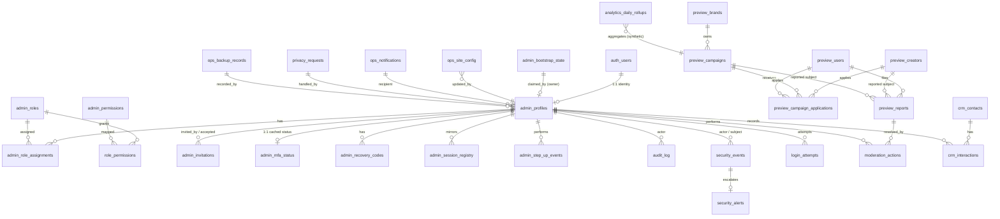

# YaarLink Admin Preview v2 — Database Schema Design (Phase 7, Design Only)

**Status:** DESIGN ONLY. No table, migration, function, policy, or trigger has been created or executed.  
**Date:** 2026-11-05  
**Target project (future implementation only):** `yaarlink-admin-preview-v2` · Ref `qwngmsedyepghskoagaj` · `ap-south-1` · Free plan  
**Production:** completely excluded. No Production connection, data, credential, table, or identifier is used anywhere in this design. All marketplace-shaped data is **synthetic Preview data only**.

This design follows `docs/ADMIN_PREVIEW_V2_ARCHITECTURE.md` (Phase 4) and `docs/ADMIN_PREVIEW_V2_AUTH_HARDENING.md` (Phase 6), in particular: invite-only access, disabled public signup (already applied), TOTP capability enabled, passkeys disabled pending review, mandatory AAL2 as an application + database enforcement requirement, first-owner bootstrap with permanent lockout, RBAC + RLS default-deny, append-only audit, synthetic-only data.

---

## 1. Design principles

1. **Default deny.** Every table has RLS enabled, no `anon` grants, and no policy exists unless explicitly listed in §10. Frontend permission checks are UX only; server and database authorize every privileged operation.
2. **Supabase Auth is the identity authority.** `auth.users` owns credentials, MFA factors (`auth.mfa_factors`), and sessions (`auth.sessions`). This design never stores passwords, TOTP seeds, or recovery-code plaintext. Application tables reference `auth.users(id)`.
3. **Schemas by trust domain:**
   - `admin` — administrator identity, RBAC, invitations, bootstrap, MFA/recovery/session metadata.
   - `audit` — append-only audit log (insert-only for the application role).
   - `security` — security events, login-attempt telemetry, alerts.
   - `preview` — synthetic marketplace-shaped modules for the future dashboard (no Production data, ever).
   - `ops` — website configuration, notifications, backups/recovery records.
   Only `preview`/`ops` read models intended for UI lists are ever exposed to an authenticated Admin session through RLS, and only with the permissions in §9–§10. `audit`/`security` are readable only by roles with explicit audit/security permissions.
4. **AAL2 is a database-visible claim.** Supabase Auth embeds `aal` (`aal1`/`aal2`) and `amr` in the JWT. RLS helper functions and server checks both require `aal = 'aal2'` for privileged access (§8).
5. **Append-only by construction.** Audit and security-event tables grant `INSERT` (and restricted `SELECT`) only; `UPDATE`/`DELETE` are revoked from all application roles and blocked by trigger as defence-in-depth (§7).
6. **Service role is server-only and scoped.** The service-role key bypasses RLS; it may be used only inside reviewed server code paths that perform their own per-operation authorization and write audit rows. It is never shipped to the browser (Phase 4 §2).

## 2. Entity Relationship Diagram

`auth_users` is `auth.users` (managed by Supabase Auth; shown for relationships only, never altered by app migrations beyond FK references).

## 3. Conventions

- PKs: `uuid DEFAULT gen_random_uuid()` unless a natural singleton/natural key is stated.
- Timestamps: `timestamptz NOT NULL DEFAULT now()` for `created_at`; `updated_at` maintained by a shared trigger where mutable.
- Soft state over deletion: administrator and marketplace records use `status` enums / `deleted_at` where retention requires history; hard `DELETE` is not granted to application roles on identity, audit, or security tables.
- All FKs to `auth.users(id)` use `ON DELETE RESTRICT` from the application side (Auth user removal is an operator action handled by the deactivation flow in §6.1, never a cascade that erases audit history). Audit actor references use `ON DELETE SET NULL` plus a denormalized `actor_auth_id` copy so history survives account removal.
- Enum types are per-schema (`admin.admin_status`, etc.) or `text` + `CHECK` where values are expected to evolve (permission keys).

---

## 4. Module A — Administrator identity

### 4.1 `admin.admin_profiles`
Purpose: one row per administrator, 1:1 with a Supabase Auth user. The single source of "who is an admin".

| Column | Type | Notes |
|---|---|---|
| `auth_user_id` | `uuid` PK, FK → `auth.users(id)` | PK enforces 1:1 |
| `display_name` | `text NOT NULL` | check length 1–120 |
| `email_snapshot` | `citext NOT NULL UNIQUE` | display/contact snapshot only; Auth remains authority. Never used for authorization |
| `status` | `admin.admin_status NOT NULL DEFAULT 'invited'` | `invited`, `active`, `suspended`, `deactivated` |
| `is_owner` | `boolean NOT NULL DEFAULT false` | first-owner / owner flag; partial unique index guarantees at least the bootstrap invariant is checkable (multiple owners allowed only by owner grant, §6.4) |
| `invited_by` | `uuid FK → admin.admin_profiles(auth_user_id)` null | null only for the first owner |
| `last_login_at` | `timestamptz` null | updated by server on session establishment |
| `suspended_at`, `suspended_reason` | `timestamptz`, `text` | set by suspension flow |
| `deactivated_at` | `timestamptz` | terminal for normal flows |
| `created_at`, `updated_at` | `timestamptz` | |

Indexes: unique `email_snapshot`; index on `status`; partial index `WHERE is_owner`.
Retention: retained indefinitely while any audit row references the admin; deactivation, not deletion.
Allowed ops: `SELECT` own row (any active admin) and rows visible to `admins.read`; `INSERT/UPDATE` server-only (service role or `SECURITY DEFINER` functions in §8.4). No direct client `INSERT/UPDATE/DELETE`.

### 4.2 `admin.admin_bootstrap_state` (singleton)
Purpose: one-time first-owner bootstrap + permanent lockout.

| Column | Type | Notes |
|---|---|---|
| `id` | `boolean` PK, `CHECK (id = true)` | singleton row |
| `owner_claimed_at` | `timestamptz` null | null ⇒ bootstrap still theoretically available |
| `owner_auth_user_id` | `uuid` FK → `auth.users(id)` null | the first owner |
| `bootstrap_disabled_at` | `timestamptz` null | set in the same transaction as the claim |
| `created_at`, `updated_at` | `timestamptz` | |

Rule (future `SECURITY DEFINER` function `admin.claim_first_owner()`, §8.4): succeeds only if `owner_claimed_at IS NULL`, caller is AAL2, caller has a verified TOTP factor, and caller's profile was created from the controlled invitation; it atomically sets the owner, inserts the `owner` role assignment, writes audit rows, and permanently disables bootstrap. There is no public setup route and no shared password (§6 of Phase 6 doc).
RLS: no client access at all; only the definer function and server service role may read/write.

### 4.3 `admin.admin_invitations`
Purpose: invite-only lifecycle, expiry, and auditability.

| Column | Type | Notes |
|---|---|---|
| `id` | `uuid` PK | |
| `email` | `citext NOT NULL` | invitee |
| `invited_by` | `uuid NOT NULL FK → admin.admin_profiles` | existing owner/admin with `admins.invite` |
| `intended_role_key` | `text` FK → `admin.admin_roles(key)` null | role proposed at invite; grant still happens server-side at acceptance |
| `status` | `text NOT NULL DEFAULT 'pending'` | `pending`, `accepted`, `expired`, `revoked`, `superseded` (CHECK) |
| `token_hash` | `bytea` null | **hash only** (SHA-256/argon2) of any app-level token; raw invite links are issued by Supabase Auth and never stored |
| `expires_at` | `timestamptz NOT NULL` | ≤ 72h from issue (CHECK guidance) |
| `accepted_at` | `timestamptz` null | |
| `accepted_auth_user_id` | `uuid` FK → `auth.users(id)` null | set on acceptance |
| `created_at`, `updated_at` | `timestamptz` | |

Indexes: index on `email`, `status`, `expires_at`; unique partial index on `email WHERE status='pending'` (one live invite per email).
Retention: 24 months for accountability, then archival per §12.
RLS: `admins.invite` holders (AAL2) may `SELECT/INSERT/UPDATE status`; no client delete. Acceptance is performed by server code that validates expiry/status before creating `admin_profiles`.

### 4.4 Account suspension / deactivation (design)
No separate table: state lives on `admin_profiles.status` with `suspended_*` / `deactivated_at`. Server flow (future): set status → revoke all sessions (§6.3) → audit `admin.suspended`/`admin.deactivated` → disable the Auth user via the server-only Admin API. RLS helper `admin.is_active_admin()` treats only `status='active'` as authorized, so suspension takes effect even before token expiry (§8.3).

## 5. Module B — RBAC

### 5.1 Tables

**`admin.admin_permissions`** — catalogue of atomic permissions.
`key text PK` (e.g. `creators.read`), `description text`, `module text NOT NULL`, `is_sensitive boolean NOT NULL DEFAULT false` (sensitive ⇒ step-up may be required, §8.5), `created_at`.

**`admin.admin_roles`**
`key text PK` (`super_admin`, `admin`, `moderator`, `support`, `auditor`), `name text`, `description text`, `is_system boolean` (system roles not deletable), `created_at`, `updated_at`.

**`admin.role_permissions`**
PK `(role_key, permission_key)`, FKs to roles/permissions, `granted_by uuid FK → admin_profiles`, `created_at`.

**`admin.admin_role_assignments`**
`id uuid PK`, `auth_user_id uuid NOT NULL FK → admin_profiles(auth_user_id)`, `role_key text NOT NULL FK → admin_roles`, `granted_by uuid FK → admin_profiles`, `granted_at timestamptz`, `expires_at timestamptz null` (time-boxed elevation), `revoked_at timestamptz null`, `revoked_by uuid`, `reason text`.
Unique partial index: `(auth_user_id, role_key) WHERE revoked_at IS NULL`. Indexes on `auth_user_id`, `role_key`.

All four tables: RLS on; `SELECT` only for active AAL2 admins with `roles.read`; writes server-only (service role / definer functions) with audit rows for every grant/revoke. Permission checks are performed server-side on every request (`admin.has_permission(key)` mirrors the same logic for RLS).

### 5.2 Proposed roles and permission matrix

Permission keys (module.action): `dashboard.view`, `admins.read`, `admins.invite`, `admins.manage`, `roles.read`, `roles.manage`, `audit.read`, `security.read`, `security.manage`, `creators.read`, `creators.manage`, `campaigns.read`, `campaigns.manage`, `brands.read`, `brands.manage`, `users.read`, `users.manage`, `moderation.read`, `moderation.act`, `site_config.read`, `site_config.manage`, `analytics.read`, `notifications.manage`, `crm.read`, `crm.manage`, `privacy.read`, `privacy.manage`, `backups.read`, `backups.manage`, `settings.manage` (sensitive), `owner.bootstrap` (bootstrap function only, never assignable).

| Permission | Super Admin | Admin | Moderator | Support | Auditor (read-only) |
|---|:---:|:---:|:---:|:---:|:---:|
| dashboard.view | ✅ | ✅ | ✅ | ✅ | ✅ |
| admins.read | ✅ | ✅ | — | — | ✅ |
| admins.invite | ✅ | — | — | — | — |
| admins.manage (suspend/deactivate) | ✅ | — | — | — | — |
| roles.read | ✅ | ✅ | — | — | ✅ |
| roles.manage | ✅ | — | — | — | — |
| audit.read | ✅ | ✅ | — | — | ✅ |
| security.read | ✅ | ✅ | — | — | ✅ |
| security.manage (alerts, force-revoke) | ✅ | — | — | — | — |
| creators.read / campaigns.read / brands.read / users.read | ✅ | ✅ | ✅ | ✅ | ✅ |
| creators.manage / campaigns.manage / brands.manage | ✅ | ✅ | — | — | — |
| users.manage | ✅ | ✅ | — | — | — |
| moderation.read | ✅ | ✅ | ✅ | ✅ | ✅ |
| moderation.act | ✅ | ✅ | ✅ | — | — |
| site_config.read | ✅ | ✅ | — | ✅ | ✅ |
| site_config.manage | ✅ | — | — | — | — |
| analytics.read | ✅ | ✅ | ✅ | ✅ | ✅ |
| notifications.manage | ✅ | ✅ | — | ✅ | — |
| crm.read / crm.manage | ✅ | ✅ | — | ✅(read)/— | ✅(read) |
| privacy.read | ✅ | ✅ | — | ✅ | ✅ |
| privacy.manage | ✅ | — | — | — | — |
| backups.read | ✅ | ✅ | — | — | ✅ |
| backups.manage | ✅ | — | — | — | — |
| settings.manage (sensitive, step-up) | ✅ | — | — | — | — |

Least-privilege notes: `super_admin` is the only role that can invite/manage admins, manage roles, manage site config/privacy/backups, or change settings; `auditor` is strictly read-only and is the default for external review; `support` cannot moderate or manage marketplace records; `moderator` cannot see admin management, CRM write, or config. Role expiry (`expires_at`) supports temporary elevation instead of permanent grants.

## 6. Module C — Security and authentication metadata

Authoritative credentials/factors/sessions stay in Supabase Auth. These tables hold *metadata and application-level artefacts only*.

### 6.1 `admin.admin_mfa_status` (cached, non-authoritative)
`auth_user_id uuid PK FK → admin_profiles`, `totp_verified_factor_count int NOT NULL DEFAULT 0`, `has_verified_totp boolean GENERATED …` (or maintained column), `last_factor_verified_at timestamptz`, `last_synced_at timestamptz NOT NULL`, `enrollment_required boolean NOT NULL DEFAULT true`.
Synced server-side from Supabase Auth factor state on login and on factor change events. RLS decisions must ultimately rely on the JWT `aal` claim, not this cache; the cache drives UX (e.g. "enrollment required") and reporting. `SELECT` own row / `security.read`; writes server-only.

### 6.2 `admin.admin_recovery_codes`
`id uuid PK`, `auth_user_id uuid NOT NULL FK → admin_profiles`, `code_hash text NOT NULL` (argon2id/bcrypt hash; **plaintext shown once at generation, never stored or logged**), `code_index smallint`, `used_at timestamptz null`, `created_at`, `invalidated_at timestamptz null`.
Unique `(auth_user_id, code_index) WHERE used_at IS NULL AND invalidated_at IS NULL` guidance; index on `auth_user_id`.
Use flow (server-only function): constant-time hash comparison, single use, rate-limited, revokes other sessions on use, writes `audit` + `security` events. RLS: **no client access**; server-only.

### 6.3 `admin.admin_session_registry` (revocation mirror)
`session_id uuid PK` (mirrors `auth.sessions.id`), `auth_user_id uuid NOT NULL FK → admin_profiles`, `aal_at_issue text`, `ip inet`, `user_agent text`, `created_at`, `last_seen_at`, `revoked_at timestamptz null`, `revoked_by uuid FK → admin_profiles`, `revoke_reason text`.
Server registers sessions at login (from Auth session data), updates `last_seen_at` opportunistically. **Revocation flow:** mark `revoked_at` here *and* delete/revoke the session via the server-only Supabase Admin API; privileged checks also test this registry / profile status so revocation is effective server-side even while an access token is unexpired (§8.3). Index on `auth_user_id`, `revoked_at`.
RLS: own sessions `SELECT` (and self-revoke request via server function); `security.manage` can read/revoke all (server-mediated).

### 6.4 `admin.admin_step_up_events`
`id uuid PK`, `auth_user_id uuid NOT NULL FK`, `action_key text NOT NULL` (the sensitive permission/action), `method text` (`totp`, `recovery_code`), `verified_at timestamptz NOT NULL DEFAULT now()`, `expires_at timestamptz NOT NULL` (short window, e.g. 10 min), `consumed_at timestamptz null`, `ip inet`.
Sensitive actions check for an unconsumed, unexpired step-up row for that action (or a fresh AAL2 challenge — §8.5). Server-only writes; own-row `SELECT` not required by client.

### 6.5 `security.login_attempts`
`id bigint GENERATED ALWAYS AS IDENTITY PK` (or uuid), `attempted_at timestamptz DEFAULT now()`, `email_attempted citext`, `auth_user_id uuid null FK → auth.users`, `outcome text CHECK` (`success`, `bad_password`, `mfa_failed`, `totp_failed`, `recovery_code_failed`, `blocked_signup`, `rate_limited`, `unknown_user`), `ip inet`, `user_agent text`, `aal_reached text null`.
Fed by server auth endpoints / Auth hooks (future). Retention 12 months (§12). RLS: `security.read` `SELECT` only; inserts server-only. This table is telemetry — it must never be used to store passwords or OTPs (values are categorised, never raw secrets).

### 6.6 `admin.account_recovery_events`
`id uuid PK`, `auth_user_id uuid NOT NULL FK`, `event_type text CHECK` (`recovery_code_used`, `recovery_codes_regenerated`, `factor_reset_requested`, `factor_reset_completed`, `password_reset_requested`, `password_reset_completed`, `owner_recovery`), `requested_by uuid FK`, `ip inet`, `created_at`, `completed_at timestamptz null`, `metadata jsonb` (non-sensitive only).
Server-only writes; `security.read`/`audit.read` select via audit correlation. Every event also writes an `audit_log` row.

## 7. Modules D & E — Audit logs and security events

### 7.1 `audit.audit_log` (append-only)
| Column | Type | Notes |
|---|---|---|
| `id` | `bigint GENERATED ALWAYS AS IDENTITY` PK | monotonic ordering |
| `occurred_at` | `timestamptz NOT NULL DEFAULT now()` | |
| `actor_auth_user_id` | `uuid` null | denormalized copy; FK-less by design so history survives deletion |
| `actor_profile_id` | `uuid` FK → `admin_profiles` ON DELETE SET NULL | |
| `actor_role_snapshot` | `text[]` | roles at time of action |
| `action` | `text NOT NULL` | e.g. `admin.invited`, `role.granted`, `campaign.updated` |
| `resource_type` | `text NOT NULL` | |
| `resource_id` | `text` | textual to cover uuid/natural keys |
| `outcome` | `text NOT NULL CHECK` | `success`, `denied`, `failed` |
| `aal_at_action` | `text` | `aal1`/`aal2`/`service` |
| `ip` / `user_agent` | `inet` / `text` | |
| `request_id` | `uuid` | correlates client/server/Production-API logs (future) |
| `before_state` / `after_state` | `jsonb` null | **redacted** diffs only; never secrets, tokens, codes, or full personal records |
| `reason` | `text` null | required for sensitive actions |
| `metadata` | `jsonb NOT NULL DEFAULT '{}'` | non-sensitive extras |

Indexes: `(occurred_at DESC)`, `(actor_auth_user_id, occurred_at DESC)`, `(resource_type, resource_id)`, `(action)`.
Append-only enforcement (future migration): `REVOKE UPDATE, DELETE` from all roles incl. the app role; `INSERT` only via server/definer path; a `BEFORE UPDATE OR DELETE` trigger raising an exception as defence-in-depth. Periodic export to encrypted off-project storage with retention/tamper-evidence (Phase 4 §5). Application must alert, not silently drop, on audit-insert failure.
RLS: `SELECT` with `audit.read` (AAL2); no client inserts (server writes with its own authorization context recorded in the row).

### 7.2 `security.security_events`
`id uuid PK`, `occurred_at timestamptz DEFAULT now()`, `event_type text CHECK` (`suspicious_login`, `repeated_failures`, `mfa_failure`, `session_revoked`, `unauthorized_access_attempt`, `aal_violation`, `recovery_code_misuse`, `invite_abuse`, `other`), `severity text CHECK` (`info`,`low`,`medium`,`high`,`critical`), `auth_user_id uuid null FK`, `actor_auth_user_id uuid null`, `ip inet`, `user_agent text`, `detail jsonb` (redacted), `created_at`.
Insert: server-only. Select: `security.read`.

### 7.3 `security.security_alerts`
`id uuid PK`, `event_id uuid FK → security_events` null, `title text`, `severity text`, `status text CHECK DEFAULT 'open'` (`open`, `acknowledged`, `investigating`, `resolved`, `dismissed`), `assigned_to uuid FK → admin_profiles`, `resolution_note text`, `resolved_by uuid FK`, `resolved_at timestamptz`, `created_at`, `updated_at`.
`security.manage` may update status/resolution (the only mutable security table); every transition writes an audit row. This status workflow is the "resolution status" required for security alerts.

## 8. Authentication & authorization flow (with MFA/AAL2)

### 8.1 Sign-in (future application)
1. User signs in with email/password via Supabase Auth (public signup disabled — Phase 6). Email verification required (`mailer_autoconfirm=false`).
2. Server resolves `admin_profiles` by `auth.uid()`; if missing, not `active`, suspended, or deactivated ⇒ deny (generic error), write `security_events(unauthorized_access_attempt)` + audit `denied`.
3. Server checks JWT `aal`. If the admin has a verified TOTP factor but session is `aal1` ⇒ MFA challenge; if no verified factor ⇒ forced enrollment flow. No privileged route/API is reachable before `aal2`.
4. On reaching AAL2, server registers/updates `admin_session_registry`, syncs `admin_mfa_status`, updates `last_login_at`, writes audit `auth.login`.

### 8.2 Per-request authorization (every privileged operation)
Server middleware **and** RLS both evaluate, in order: authenticated session → profile exists & `active` → session not in `admin_session_registry.revoked_at` → `aal='aal2'` → role permission (`admin.has_permission`) → resource scope → (if permission `is_sensitive`) fresh step-up (§8.5). Any failure ⇒ 403 + audit `denied` (+ security event for AAL/permission violations). Frontend hiding of controls is never the control.

### 8.3 Why revocation works despite JWT lifetime
Access tokens live ≤ 3600s (Phase 6). Privileged server checks consult live state on every request (profile status + session registry + Auth session validity via the server client), so suspending an admin or revoking a session denies the next request even with an unexpired token. Refresh rotation is enabled; reuse interval 10s.

### 8.4 Database helper functions (future `SECURITY DEFINER`, `search_path` locked)
- `admin.current_admin_id()` → `auth.uid()` mapped to an active profile, else null.
- `admin.is_active_admin()` → profile exists and `status='active'`.
- `admin.has_aal2()` → `(auth.jwt() ->> 'aal') = 'aal2'`.
- `admin.has_permission(p_key)` → active + AAL2 + unexpired, unrevoked role assignment granting `p_key`.
- `admin.claim_first_owner()` → §4.2 rules; the only path that sets `is_owner` initially.
- `admin.grant_role(...)` / `admin.revoke_role(...)` → caller must hold the corresponding manage permission at AAL2; writes assignments + audit atomically.
RLS policies call these helpers; direct table writes by clients stay revoked (policies are defence-in-depth behind server authorization, not a substitute for it).

### 8.5 Step-up authentication
Sensitive permissions (flagged `is_sensitive`, e.g. `settings.manage`, role grants, alert dismissal, privacy exports) require either a fresh TOTP challenge within the step-up window or an unconsumed `admin_step_up_events` row for that action. First-owner claim (§4.2) always requires step-up-grade fresh AAL2 and can never bypass MFA: no verified factor ⇒ claim function rejects.

## 9. Module F — Future dashboard modules (`preview`/`ops`, synthetic only)

All rows are fictional seed data. No FK, view, function, or job connects these tables to Production. Suggested synthetic marker: every `preview` table carries `is_synthetic boolean NOT NULL DEFAULT true CHECK (is_synthetic)` as a tripwire against accidental real-data import.

| Table | Key columns (PK uuid unless noted) | Relationships / constraints | Retention |
|---|---|---|---|
| `preview.preview_creators` | `display_name`, `handle citext UNIQUE`, `niche`, `status` (`active`,`flagged`,`suspended`), `follower_band`, timestamps | referenced by applications/reports | keep while referenced; soft-delete |
| `preview.preview_brands` | `name`, `industry`, `status`, timestamps | owns campaigns | as above |
| `preview.preview_users` | `display_name`, `email citext UNIQUE` (example-domain only, CHECK `LIKE '%@example.%'` guidance), `status` | files reports, applies | as above |
| `preview.preview_campaigns` | `brand_id FK`, `title`, `status` (`draft`,`live`,`paused`,`ended`), `budget_band`, `starts_on`, `ends_on` | brand 1:N | as above |
| `preview.preview_campaign_applications` | `campaign_id FK`, `applicant_type` (`creator`,`user`), `creator_id FK null`, `user_id FK null`, `status` (`applied`,`shortlisted`,`rejected`,`accepted`), CHECK exactly one applicant FK | unique `(campaign_id, creator_id)`, `(campaign_id, user_id)` | as above |
| `preview.preview_reports` | `reporter_user_id FK`, `subject_type` (`creator`,`campaign`,`user`), `subject_id uuid`, `reason`, `status` (`open`,`reviewing`,`resolved`,`dismissed`) | polymorphic subject documented, validated server-side | 24 months |
| `preview.moderation_actions` | `report_id FK`, `admin_id FK → admin_profiles`, `action`, `note`, `created_at` | admin performs; audited | 24 months |
| `ops.ops_site_config` | `key text PK`, `value jsonb`, `updated_by FK`, `updated_at` | single-row-per-key config; writes `site_config.manage` + audit before/after | version via audit |
| `preview.analytics_daily_rollups` | PK `(day date, metric text, campaign_id uuid null)`, `value numeric` | synthetic aggregates only | 13 months |
| `ops.ops_notifications` | `recipient_admin_id FK null`, `channel`, `template_key`, `payload jsonb` (non-sensitive), `status`, `sent_at` | broadcast if recipient null | 6 months |
| `preview.crm_contacts` / `preview.crm_interactions` | contact: `name`, `company`, `email`, `stage`; interaction: `contact_id FK`, `admin_id FK`, `kind`, `note`, `created_at` | fictional CRM pipeline | 24 months |
| `preview.privacy_requests` | `requester_email`, `request_type` (`access`,`export`,`deletion`,`correction`), `status`, `handled_by FK`, `due_at`, `completed_at` | synthetic requesters only | per policy, min 12 months metadata |
| `ops.ops_backup_records` | `backup_type`, `scope`, `status`, `location_label` (no credentials/URLs with secrets), `size_bytes`, `checksum`, `started_at`, `finished_at`, `recorded_by FK`, `restore_tested_at`, `notes` | operational register, not the backup itself | 36 months |

RLS for Module F: active AAL2 admin + module `*.read` to `SELECT`; `*.manage`/`moderation.act` to `INSERT/UPDATE` (server-mediated); no client `DELETE` (soft-delete via `status`/`deleted_at` where present). Every manage action writes an `audit_log` row with redacted before/after.

## 10. RLS policy matrix (summary)

`—` = no policy (denied). All policies additionally require an active profile; "AAL2+perm" means `admin.has_permission(...)` (which itself requires AAL2, §8.4).

| Table | anon | authenticated non-admin | Admin AAL1 | Admin AAL2 + perm | Server (service role / definer) |
|---|---|---|---|---|---|
| `admin_profiles` | — | own row only if profile exists* | own row `SELECT` | `admins.read` `SELECT` all | full (own authz + audit) |
| `admin_bootstrap_state` | — | — | — | — | claim function only |
| `admin_invitations` | — | — | — | `admins.invite`: `SELECT/INSERT/UPDATE status` | full |
| `admin_roles`, `admin_permissions`, `role_permissions` | — | — | — | `roles.read` `SELECT` | full (audited) |
| `admin_role_assignments` | — | own assignments `SELECT` | own `SELECT` | `roles.read` `SELECT` | grant/revoke functions only |
| `admin_mfa_status` | — | — | own `SELECT` | `security.read` `SELECT` | sync writes |
| `admin_recovery_codes` | — | — | — | — | server-only |
| `admin_session_registry` | — | — | own `SELECT` | `security.read` `SELECT` | register/revoke |
| `admin_step_up_events` | — | — | — | — | server-only |
| `account_recovery_events` | — | — | — | `security.read` `SELECT` | inserts |
| `login_attempts` | — | — | — | `security.read` `SELECT` | inserts |
| `audit.audit_log` | — | — | — | `audit.read` `SELECT` | `INSERT` only (no UPDATE/DELETE anywhere) |
| `security_events` | — | — | — | `security.read` `SELECT` | `INSERT` only |
| `security_alerts` | — | — | — | `security.read` `SELECT`; `security.manage` status `UPDATE` | full |
| Module F tables | — | — | — | `*.read` `SELECT`; `*.manage` write | full (audited) |

\* "Own row" for a non-admin authenticated user returns at most their own profile row; since profiles are only created for invited admins, ordinary Auth users (none expected in this project) see nothing. This is defence-in-depth; the Admin app also rejects non-admins server-side (§8.1 step 2).

Unauthorized-user prevention, in one place: (1) public signup disabled (Phase 6) so attackers cannot mint Auth users; (2) no `anon` policies/grants; (3) profiles created only by invite/acceptance server flow; (4) RLS helpers require active profile + AAL2 + permission; (5) direct client writes revoked on identity/security tables; (6) service role confined to server code.

## 11. Index & constraint plan (summary beyond per-table notes)

- Identity/RBAC: PKs and unique constraints in §§4–5; partial unique live-invite index; partial unique live role-assignment index; FK indexes on every FK column.
- Audit/security: time-ordered indexes in §7; `security_events(event_type, occurred_at)`, `security_alerts(status, severity)`; `login_attempts(email_attempted, attempted_at)`, `(ip, attempted_at)` for throttling analytics.
- Module F: FK indexes; `preview_reports(status, created_at)`; `preview_campaign_applications(campaign_id, status)`; rollups PK covers day/metric queries.
- Integrity: `CHECK`s on all status/outcome enums, expiry > creation on invitations/assignments/step-ups, exactly-one-applicant on applications, synthetic-marker CHECK on `preview` tables, example-domain CHECK guidance for synthetic emails.
- No indexes on secret-bearing columns (hashes are looked up by user + index, never by hash alone).

## 12. Data retention & recovery recommendations

| Data | Retention | Recovery note |
|---|---|---|
| Audit log | ≥ 24 months hot, then encrypted off-project archive (Phase 4 §5) | included in DB backups; off-project export is the tamper-evident copy |
| Security events / alerts / login attempts | 12–24 months | as above |
| Invitations, role assignments (incl. revoked) | 24 months | needed for access reviews |
| Recovery-code metadata | until invalidated + 12 months | hashes only; useless if leaked, still treat as sensitive |
| Sessions registry | 12 months | operational |
| Synthetic marketplace data | resettable fixtures; no legal retention | can be reseeded; never restored into Production |
| Backup records register | 36 months | register is metadata; actual backups per Phase 4 §5 (daily encrypted, ≥7-day PITR target, quarterly restore tests) |

Recovery follows Phase 4 §5: restore to a separate recovery project, validate RLS/MFA/audit, rotate credentials, never restore into Production. Auth users/factors recovery is a separate concern (re-invitation + MFA re-enrollment if factors cannot be restored).

## 13. Proposed migration execution order (future, approval-gated)

1. Schemas (`admin`, `audit`, `security`, `preview`, `ops`) + enum types + `updated_at` trigger helper.
2. Identity tables (§4) incl. bootstrap singleton seed row.
3. RBAC tables (§5.1) + seed permission catalogue and system roles + role-permission matrix (§5.2).
4. Security metadata tables (§6) + audit (§7.1) + security events/alerts (§7.2–7.3), incl. append-only revokes/triggers.
5. Helper functions (§8.4) and RLS enablement + policies (§10) — **in the same migration series as the tables they protect; a table must never exist without RLS enabled.**
6. Module F tables (§9) + their policies.
7. Indexes/constraints not created inline (§11).
8. Synthetic seed fixtures (clearly fictional, example domains) — separate seed step, never in Production.
9. Verification suite (§14) run against the Preview project only.
Each step is a separate, reviewable migration; no step is executed in Phase 7.

## 14. Testing strategy (future implementation phase)

- **RLS tests:** anon denied everywhere; authenticated non-admin denied; AAL1 denied privileged reads; each role × permission cell of §5.2/§10 tested allow/deny; cross-admin record access denied; suspended/deactivated admin denied immediately.
- **Bootstrap tests:** claim succeeds once (AAL2 + verified factor + invited profile), second claim fails, claim without MFA fails, no public route reaches the function.
- **MFA/AAL2 tests:** login at AAL1 cannot read privileged tables; after TOTP challenge AAL2 succeeds; step-up required for `is_sensitive` actions and expires.
- **Revocation tests:** suspend admin / revoke session ⇒ next privileged request denied despite unexpired token; recovery-code use revokes other sessions; codes single-use and hash-only at rest (inspect stored values in test).
- **Audit tests:** UPDATE/DELETE on `audit_log` fail for every role incl. app role; sensitive action writes redacted before/after; audit-insert failure surfaces an alert.
- **Invite lifecycle:** expired/revoked/superseded invites cannot create profiles; duplicate pending invite prevented; acceptance does not itself grant roles beyond the approved intended role flow.
- **Synthetic-data guard:** seed uses example domains only; a check asserts no Production host/ref strings exist in Preview configuration (Phase 4 §2 test).
- **Config regression:** `disable_signup` still true, passkeys still disabled, Site URL/redirects set before first invite (see §15).

## 15. Unresolved issues from Phase 6 (explicitly NOT complete)

| # | Issue | State | Proposed resolving phase |
|---|---|---|---|
| 1 | Supabase Site URL + redirect allowlist not configured (still default `http://localhost:3000`, empty allowlist) | **Open** — blocks invitations and any invite-flow test | **Phase 8 (pre-implementation configuration):** approve the Admin Preview origin, then set exact Site URL + redirect paths; no Production URL may be used |
| 2 | Password policy weak (min 6 chars, no character rules, leaked-password check off) | **Open** — not settable via the Phase 6 connector | **Phase 8:** strengthen in Supabase dashboard (≥12 chars, character rules, HIBP leaked-password check) and record verification |
| 3 | Mandatory AAL2 enforcement not implemented (TOTP capability only) | **Open** — designed in §8, not built | **Phase 9 (Admin auth implementation):** server middleware + RLS helper enforcement + tests §14; schema helpers land with Phase 8 migrations |
| 4 | No first Super Admin account created | **Open** — intentionally deferred | **Phase 10 (controlled first-owner creation):** after Phases 8–9 verified, execute §4.2/Phase 6 §6 bootstrap with the named owner, then confirm permanent lockout |

None of these is marked complete anywhere in this design. Phase 8 itself (executing §13) requires separate explicit approval after this design is reviewed.

## 16. Security risks & mitigation checklist

- [ ] Service-role key leakage → server-only, scoped wrapper, never in browser/env-public vars; rotate on suspicion.
- [ ] AAL1 token used against PostgREST directly → RLS requires `aal2` via helpers (§8.4); test direct-API access, not only UI.
- [ ] Role granted via editable user metadata → roles live only in `admin_role_assignments`; never trust client claims.
- [ ] Audit tampering by app role → revokes + trigger + off-project export (§7.1).
- [ ] Recovery-code brute force → hashed storage, rate limiting, single use, session revocation on use, security events.
- [ ] Invite forwarding/abuse → short expiry (≤72h), single pending invite per email, acceptance bound to invited email, audit.
- [ ] Session revocation lag → per-request live status checks (§8.3); short JWT lifetime retained.
- [ ] Synthetic data contaminated with real data → `is_synthetic` tripwire, example-domain guidance, seed review, no Production import path exists.
- [ ] Privileged server function misuse → `SECURITY DEFINER` functions lock `search_path`, check caller permission + AAL2 internally, audit atomically.
- [ ] Free-plan limits (backups/PITR/Auth rate limits) → confirm against Phase 4 §5 before relying on the environment; any paid need returns to the user for approval (no purchase in this design).

## 17. Phase 7 non-action confirmation

This document is the only artefact of Phase 7. No database table, migration, SQL, Auth setting, Vercel variable, deployment, or Production resource was created, queried, or modified, and no secret was exposed. Implementation (§13) begins only after personal review and explicit approval of this design.
