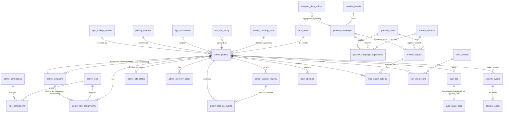

# YaarLink Admin Preview v2 — Database Schema Design (Phase 7, Design Only)

**Status:** DESIGN ONLY. No table, migration, function, policy, or trigger has been created or executed.  
**Date:** 2026-11-05  
**Target project (future implementation only):** `yaarlink-admin-preview-v2` · Ref `qwngmsedyepghskoagaj` · `ap-south-1` · Free plan  
**Production:** completely excluded. No Production connection, data, credential, table, or identifier is used anywhere in this design. All marketplace-shaped data is **synthetic Preview data only**.

This design follows `docs/ADMIN_PREVIEW_V2_ARCHITECTURE.md` (Phase 4) and `docs/ADMIN_PREVIEW_V2_AUTH_HARDENING.md` (Phase 6), in particular: invite-only access, disabled public signup (already applied), TOTP capability enabled, passkeys disabled pending review, mandatory AAL2 as an application + database enforcement requirement, first-owner bootstrap with permanent lockout, RBAC + RLS default-deny, append-only audit, synthetic-only data.

---

## 1. Design principles

1. **Default deny.** Every table has RLS enabled, no `anon` grants, and no policy exists unless explicitly listed in §10. Frontend permission checks are UX only; server and database authorize every privileged operation.
2. **Supabase Auth is the identity authority.** `auth.users` owns credentials, MFA factors (`auth.mfa_factors`), and sessions (`auth.sessions`). This design never stores passwords, TOTP seeds, or recovery-code plaintext. Application tables reference `auth.users(id)`.
3. **Schemas by trust domain:**
   - `admin` — administrator identity, RBAC, invitations, bootstrap, MFA/recovery/session metadata.
   - `audit` — append-only audit log (insert-only for the application role).
   - `security` — security events, login-attempt telemetry, alerts.
   - `preview` — synthetic marketplace-shaped modules for the future dashboard (no Production data, ever).
   - `ops` — website configuration, notifications, backups/recovery records.
   Only `preview`/`ops` read models intended for UI lists are ever exposed to an authenticated Admin session through RLS, and only with the permissions in §9–§10. `audit`/`security` are readable only by roles with explicit audit/security permissions.
4. **AAL2 is a database-visible claim.** Supabase Auth embeds `aal` (`aal1`/`aal2`) and `amr` in the JWT. RLS helper functions and server checks both require `aal = 'aal2'` for privileged access (§8).
5. **Append-only by construction.** Audit and security-event tables grant `INSERT` (and restricted `SELECT`) only; `UPDATE`/`DELETE` are revoked from all application roles and blocked by trigger as defence-in-depth (§7).
6. **Service role is server-only and scoped.** The service-role key bypasses RLS; it may be used only inside reviewed server code paths that perform their own per-operation authorization and write audit rows. It is never shipped to the browser (Phase 4 §2).

## 2. Entity Relationship Diagram



`auth_users` is `auth.users` (managed by Supabase Auth; shown for relationships only, never altered by app migrations beyond FK references).

## 3. Conventions

- PKs: `uuid DEFAULT gen_random_uuid()` unless a natural singleton/natural key is stated.
- Timestamps: `timestamptz NOT NULL DEFAULT now()` for `created_at`; `updated_at` maintained by a shared trigger where mutable.
- Soft state over deletion: administrator and marketplace records use `status` enums / `deleted_at` where retention requires history; hard `DELETE` is not granted to application roles on identity, audit, or security tables.
- All FKs to `auth.users(id)` use `ON DELETE RESTRICT` from the application side (Auth user removal is an operator action handled by the deactivation flow in §6.1, never a cascade that erases audit history). Audit actor references use `ON DELETE SET NULL` plus a denormalized `actor_auth_id` copy so history survives account removal.
- Enum types are per-schema (`admin.admin_status`, etc.) or `text` + `CHECK` where values are expected to evolve (permission keys).

---

## 4. Module A — Administrator identity

### 4.1 `admin.admin_profiles`
Purpose: one row per administrator, 1:1 with a Supabase Auth user. The single source of "who is an admin".

| Column | Type | Notes |
|---|---|---|
| `auth_user_id` | `uuid` PK, FK → `auth.users(id)` | PK enforces 1:1 |
| `display_name` | `text NOT NULL` | check length 1–120 |
| `email_snapshot` | `citext NOT NULL UNIQUE` | display/contact snapshot only; Auth remains authority. Never used for authorization |
| `status` | `admin.admin_status NOT NULL DEFAULT 'invited'` | `invited`, `active`, `suspended`, `deactivated` |
| `is_owner` | `boolean NOT NULL DEFAULT false` | **Phase 7.3 ownership model:** exactly one row may have `is_owner=true` at any time, enforced by a partial unique index `UNIQUE (is_owner) WHERE is_owner` (one permanent owner; ownership is *transferable* only through the owner-transfer function §20.1, never by role grant). `is_owner` is an ownership marker, not a role |
| `invited_by` | `uuid FK → admin.admin_profiles(auth_user_id)` **NULL** | null exactly when `invitation_id` references the bootstrap invitation (no prior admin exists); otherwise the inviting admin. This resolves the Phase 7 NULL/NOT NULL contradiction: the column is nullable by design, with a CHECK that `invited_by IS NULL` only for the bootstrap-originated profile |
| `invitation_id` | `uuid FK → admin.admin_invitations(id)` null | the invitation that produced this profile; UNIQUE where present — one invitation creates at most one profile |
| `invitation_kind` | `text NOT NULL CHECK (invitation_kind IN ('admin_invite','bootstrap'))` | **Phase 7.4:** denormalized, immutable copy of the producing invitation's kind, written once at profile creation. Together with the deferred constraint trigger in §20.10 it enforces — without any cross-table CHECK — that the first owner's profile references a `bootstrap` invitation and ordinary profiles reference `admin_invite` |
| `last_login_at` | `timestamptz` null | updated by server on session establishment |
| `suspended_at`, `suspended_reason` | `timestamptz`, `text` | set by suspension flow |
| `deactivated_at` | `timestamptz` | terminal for normal flows |
| `created_at`, `updated_at` | `timestamptz` | |

Indexes: unique `email_snapshot`; index on `status`; **partial unique index `(is_owner) WHERE is_owner`** (database-enforced single owner); unique partial index `(invitation_id) WHERE invitation_id IS NOT NULL`.
Retention: retained indefinitely while any audit row references the admin; deactivation, not deletion.
Allowed ops: `INSERT/UPDATE` server-only (service role or `SECURITY DEFINER` functions in §8.4); no client `DELETE`. **Column-level security (Phase 7.3):** direct table `SELECT` is revoked from `authenticated`; admins read profiles only through `admin.admin_profile_directory` view (columns: `auth_user_id`, `display_name`, `status`, `is_owner`, role keys — **never** `email_snapshot`, IPs, or security metadata) gated by `admins.read`, and their own full row through `admin.my_profile` view (`auth.uid() = auth_user_id`, excluding recovery/session internals). `email_snapshot` is visible only to `admins.read` holders via the directory view variant used by the server, never to AAL1.

### 4.2 `admin.admin_bootstrap_state` (singleton)
Purpose: one-time first-owner bootstrap + permanent lockout.

| Column | Type | Notes |
|---|---|---|
| `id` | `boolean` PK, `CHECK (id = true)` | singleton row |
| `owner_claimed_at` | `timestamptz` null | null ⇒ bootstrap still theoretically available |
| `owner_auth_user_id` | `uuid` FK → `auth.users(id)` null | the first owner |
| `bootstrap_disabled_at` | `timestamptz` null | set in the same transaction as the claim |
| `created_at`, `updated_at` | `timestamptz` | |

Rule (future `SECURITY DEFINER` function `admin.claim_first_owner()`, §8.4): succeeds only if `owner_claimed_at IS NULL`, caller is AAL2, caller has a verified TOTP factor, and caller's profile was created from the controlled invitation; it atomically sets the owner, inserts the `owner` role assignment, writes audit rows, and permanently disables bootstrap. There is no public setup route and no shared password (§6 of Phase 6 doc).

**Phase 7.1 correction (mandatory, race-proofing):** the claim must be a single atomic conditional update — `UPDATE admin_bootstrap_state SET owner_claimed_at = now(), owner_auth_user_id = <caller>, bootstrap_disabled_at = now() WHERE id = true AND owner_claimed_at IS NULL RETURNING …` — executed after locking the singleton row (`SELECT … FOR UPDATE`) inside one transaction. If the update affects zero rows, the claim fails. Check-then-insert without this atomic guard is prohibited: two simultaneous claims must not both succeed. Additionally: (a) the caller's profile must trace to the operator-authorized bootstrap invitation (`invitation_kind='bootstrap'`, `intended_role_key='super_admin'`) per §20.1 — an ordinary `admin_invite` can never be upgraded into an owner claim (Phase 7.3 supersedes the earlier 'granter held owner authority' wording, which was circular: no owner exists at bootstrap); (b) the singleton conditional update is the sole race guard and must be concurrency-tested (§14); (c) if the first owner is ever created via the Supabase dashboard instead, an equivalent `admin_invitations` + audit record must be written in the same operator procedure, or the bootstrap state will falsely appear unclaimed.
RLS: no client access at all; only the definer function and server service role may read/write.

### 4.3 `admin.admin_invitations`
Purpose: invite-only lifecycle, expiry, and auditability.

| Column | Type | Notes |
|---|---|---|
| `id` | `uuid` PK | |
| `email` | `citext NOT NULL` | invitee |
| `invited_by` | `uuid FK → admin.admin_profiles` **NULL** | the inviting admin; **NULL only when `invitation_kind='bootstrap'`** (trusted-operator bootstrap, §20.1) with CHECK `(invitation_kind='bootstrap') = (invited_by IS NULL)` for pending operator invites |
| `invitation_kind` | `text NOT NULL DEFAULT 'admin_invite' CHECK (invitation_kind IN ('admin_invite','bootstrap'))` | bootstrap invitations are created only by the Phase 7.3 operator procedure (§20.1), never by an API available to non-owners |
| `operator_authorization_ref` | `text` null | non-secret reference to the out-of-band operator approval (ticket/change ID) — required for `bootstrap`, forbidden to contain tokens |
| `intended_role_key` | `text` FK → `admin.admin_roles(key)` null | role proposed at invite; grant still happens server-side at acceptance |
| `status` | `text NOT NULL DEFAULT 'pending'` | `pending`, `accepted`, `expired`, `revoked`, `superseded` (CHECK) |
| `token_hash` | `bytea` null | **hash only**: `SHA-256` over the high-entropy application token (tokens are ≥256-bit random, so a fast hash is appropriate; passwords/codes still use argon2id per §6.2). Raw Supabase Auth invite links are never stored. The accepted token is compared in constant time by the server and the row is consumed atomically (status `pending → accepted` conditional UPDATE) |
| `expires_at` | `timestamptz NOT NULL` | ≤ 72h from issue (CHECK guidance) |
| `accepted_at` | `timestamptz` null | |
| `accepted_auth_user_id` | `uuid` FK → `auth.users(id)` null | set on acceptance |
| `created_at`, `updated_at` | `timestamptz` | |

Indexes: index on `email`, `status`, `expires_at`; unique partial index on `email WHERE status='pending'` (one live invite per email); **unique partial index `(accepted_auth_user_id) WHERE accepted_auth_user_id IS NOT NULL`** (one Auth user can accept at most one invitation); index on `accepted_auth_user_id`. Acceptance rules (Phase 7.3, §20.1): email must match the Auth account email (case-insensitive), expiry/revocation are re-checked inside the acceptance transaction, and retries are idempotent — replaying an accepted invitation returns the existing profile/grant instead of duplicating them.
Retention: 24 months for accountability, then archival per §12.
RLS: `admins.invite` holders (AAL2) may `SELECT/INSERT/UPDATE status`; no client delete. Acceptance is performed by server code that validates expiry/status before creating `admin_profiles`.

### 4.4 Account suspension / deactivation (design)
No separate table: state lives on `admin_profiles.status` with `suspended_*` / `deactivated_at`. Server flow (future): set status → revoke all sessions (§6.3) → audit `admin.suspended`/`admin.deactivated` → disable the Auth user via the server-only Admin API. RLS helper `admin.is_active_admin()` treats only `status='active'` as authorized, so suspension takes effect even before token expiry (§8.3).

## 5. Module B — RBAC

### 5.1 Tables

**`admin.admin_permissions`** — catalogue of atomic permissions.
`key text PK` (e.g. `creators.read`), `description text`, `module text NOT NULL`, `is_sensitive boolean NOT NULL DEFAULT false` (sensitive ⇒ step-up may be required, §8.5), `created_at`.

**`admin.admin_roles`**
`key text PK` (`super_admin`, `admin`, `moderator`, `support`, `auditor`), `name text`, `description text`, `is_system boolean` (system roles not deletable), `created_at`, `updated_at`.

**`admin.role_permissions`**
PK `(role_key, permission_key)`, FKs to roles/permissions, `granted_by uuid FK → admin_profiles`, `created_at`.

**`admin.admin_role_assignments`**
`id uuid PK`, `auth_user_id uuid NOT NULL FK → admin_profiles(auth_user_id)`, `role_key text NOT NULL FK → admin_roles`, `granted_by uuid FK → admin_profiles`, `granted_at timestamptz`, `expires_at timestamptz null` (time-boxed elevation), `revoked_at timestamptz null`, `revoked_by uuid`, `reason text`.
**Role-assignment lifecycle (Phase 7.3 correction):** the earlier partial unique index `WHERE revoked_at IS NULL` was wrong — an *expired-but-unrevoked* row blocked reassignment, and a predicate using `now()` is not permitted in an index. Instead: a stored `is_current boolean NOT NULL DEFAULT true` is maintained **only** by the grant/revoke/expire functions; partial unique index `(auth_user_id, role_key) WHERE is_current`. Expiry is applied by a race-safe conditional transition (`UPDATE … SET is_current=false, revoked_at=COALESCE(revoked_at, now()), revoke_reason='expired' WHERE id=… AND is_current`), executed by the grant function (and a scheduled job) *inside the same transaction* before inserting the replacement row. Simultaneous grants serialize on the partial unique index: exactly one succeeds, the other receives a uniqueness conflict and must re-read state — never a duplicate live grant. `has_permission` checks `is_current AND (expires_at IS NULL OR expires_at > now())` at query time, so an expired assignment stops conferring permission immediately even before the transition job runs.

All four tables: RLS on; `SELECT` only for active AAL2 admins with `roles.read`; writes server-only (service role / definer functions) with audit rows for every grant/revoke. Permission checks are performed server-side on every request (`admin.has_permission(key)` mirrors the same logic for RLS).

### 5.2 Proposed roles and permission matrix

Permission catalogue (**Phase 7.3 corrected count: 30 assignable permissions**, listed below, **plus 1 non-assignable catalogue entry** `owner.bootstrap` used only by the bootstrap function — 31 catalogue rows in total; the RBAC matrix in this section, the seed plan in §13, and the tests in §14/§20.9 must all use exactly this catalogue): `dashboard.view`, `admins.read`, `admins.invite`, `admins.manage`, `roles.read`, `roles.manage`, `audit.read`, `security.read`, `security.manage`, `creators.read`, `creators.manage`, `campaigns.read`, `campaigns.manage`, `brands.read`, `brands.manage`, `users.read`, `users.manage`, `moderation.read`, `moderation.act`, `site_config.read`, `site_config.manage`, `analytics.read`, `notifications.manage`, `crm.read`, `crm.manage`, `privacy.read`, `privacy.manage`, `backups.read`, `backups.manage`, `settings.manage` (sensitive), `owner.bootstrap` (bootstrap function only, never assignable).

| Permission | Super Admin | Admin | Moderator | Support | Auditor (read-only) |
|---|:---:|:---:|:---:|:---:|:---:|
| dashboard.view | ✅ | ✅ | ✅ | ✅ | ✅ |
| admins.read | ✅ | ✅ | — | — | ✅ |
| admins.invite | ✅ | — | — | — | — |
| admins.manage (suspend/deactivate) | ✅ | — | — | — | — |
| roles.read | ✅ | ✅ | — | — | ✅ |
| roles.manage | ✅ | — | — | — | — |
| audit.read | ✅ | ✅ | — | — | ✅ |
| security.read | ✅ | ✅ | — | — | ✅ |
| security.manage (alerts, force-revoke) | ✅ | — | — | — | — |
| creators.read / campaigns.read / brands.read / users.read | ✅ | ✅ | ✅ | ✅ | ✅ |
| creators.manage / campaigns.manage / brands.manage | ✅ | ✅ | — | — | — |
| users.manage | ✅ | ✅ | — | — | — |
| moderation.read | ✅ | ✅ | ✅ | ✅ | ✅ |
| moderation.act | ✅ | ✅ | ✅ | — | — |
| site_config.read | ✅ | ✅ | — | ✅ | ✅ |
| site_config.manage | ✅ | — | — | — | — |
| analytics.read | ✅ | ✅ | ✅ | ✅ | ✅ |
| notifications.manage | ✅ | ✅ | — | ✅ | — |
| crm.read | ✅ | ✅ | — | ✅ | ✅ |
| crm.manage | ✅ | ✅ | — | — | — |
| privacy.read | ✅ | ✅ | — | ✅ | ✅ |
| privacy.manage | ✅ | — | — | — | — |
| backups.read | ✅ | ✅ | — | — | ✅ |
| backups.manage | ✅ | — | — | — | — |
| settings.manage (sensitive, step-up) | ✅ | — | — | — | — |

Least-privilege notes: `super_admin` is the only role that can invite/manage admins, manage roles, manage site config/privacy/backups, or change settings; `auditor` is strictly read-only and is the default for external review; `support` cannot moderate or manage marketplace records; `moderator` cannot see admin management, CRM write, or config. Role expiry (`expires_at`) supports temporary elevation instead of permanent grants.

## 6. Module C — Security and authentication metadata

Authoritative credentials/factors/sessions stay in Supabase Auth. These tables hold *metadata and application-level artefacts only*.

### 6.1 `admin.admin_mfa_status` (cached, non-authoritative)
`auth_user_id uuid PK FK → admin_profiles`, `totp_verified_factor_count int NOT NULL DEFAULT 0`, `has_verified_totp boolean NOT NULL DEFAULT false` (**Phase 7.4:** a plain *maintained cache column* written by the server sync job — it is **non-authoritative** and must never be used as an authorization input; see §20.11), `last_factor_verified_at timestamptz`, `last_synced_at timestamptz NOT NULL`, `enrollment_required boolean NOT NULL DEFAULT true`.
Synced server-side from Supabase Auth factor state on login and on factor change events. RLS decisions must ultimately rely on the JWT `aal` claim, not this cache; the cache drives UX (e.g. "enrollment required") and reporting. `SELECT` own row / `security.read`; writes server-only.

### 6.2 `admin.admin_recovery_codes`
`id uuid PK`, `auth_user_id uuid NOT NULL FK → admin_profiles`, `code_hash text NOT NULL` (argon2id/bcrypt hash; **plaintext shown once at generation, never stored or logged**), `code_index smallint`, `used_at timestamptz null`, `created_at`, `invalidated_at timestamptz null`.
Unique `(auth_user_id, code_index) WHERE used_at IS NULL AND invalidated_at IS NULL` guidance; index on `auth_user_id`.
Use flow (server-only function): constant-time hash comparison, single use, rate-limited, revokes other sessions on use, writes `audit` + `security` events. RLS: **no client access**; server-only.

**Phase 7.1 corrections (mandatory):** hashing is performed in server application code with argon2id (or bcrypt) plus a server-side pepper held only in the secret store — never in SQL, never a fast unsalted hash. Verification must atomically consume the code (`UPDATE … SET used_at = now() WHERE id = … AND used_at IS NULL AND invalidated_at IS NULL RETURNING …`); zero rows ⇒ failure. Failed attempts are counted per admin with lockout + `security_events` escalation after a small threshold. Using a recovery code must never by itself grant AAL2-equivalent privilege: the admin must set a new password **and** re-enroll/verify TOTP before privileged access resumes, and all existing sessions are revoked. Supabase Auth has no native recovery-code concept — this is application-level only and must be tested as such (§14).

### 6.3 `admin.admin_session_registry` (revocation mirror)
`session_id uuid PK` (mirrors `auth.sessions.id`), `auth_user_id uuid NOT NULL FK → admin_profiles`, `aal_at_issue text`, `ip inet`, `user_agent text`, `created_at`, `last_seen_at`, `revoked_at timestamptz null`, `revoked_by uuid FK → admin_profiles`, `revoke_reason text`.
Server registers sessions at login (from Auth session data), updates `last_seen_at` opportunistically. **Revocation flow (Phase 7.4 corrected):** mark `revoked_at` here and, where the documented Supabase sign-out API is applicable (§20.5 — current-session `local`, all-own-sessions `global`/`others` using that user's own session context), revoke the corresponding refresh tokens. There is **no verified Admin API to delete an arbitrary session of another user by session ID**, and `auth.*` tables are never modified directly; for another admin's session the registry mark (enforced by `admin.session_is_current()` in every privileged RLS policy) plus profile status is the immediate barrier, effective on the next request even while an access token is unexpired (§§8.3, 20.5). Index on `auth_user_id`, `revoked_at`.
RLS: own sessions `SELECT` (and self-revoke request via server function); `security.manage` can read/revoke all (server-mediated).

### 6.4 `admin.admin_step_up_events`
`id uuid PK`, `auth_user_id uuid NOT NULL FK`, `session_id uuid NOT NULL` (Phase 7.3: bound to the exact Supabase Auth session — the JWT `session_id` claim; a step-up minted in one session is invalid in any other), `action_key text NOT NULL` (the sensitive permission/action), `resource_key text` null (resource/operation identifier where applicable; a step-up bound to a resource never authorizes a different resource), `method text NOT NULL CHECK (method = 'totp')` (**Phase 7.3: `recovery_code` is removed as a step-up method** — recovery codes never grant AAL2 or step-up, §6.2), `amr_totp_timestamp timestamptz` (timestamp of the `totp` entry in the JWT `amr` claim observed by the server at issuance, §20.3), `verified_at timestamptz NOT NULL DEFAULT now()`, `expires_at timestamptz NOT NULL` (CHECK `expires_at <= verified_at + interval '10 minutes'`), `consumed_at timestamptz null`, `ip inet`.
Sensitive actions check for an unconsumed, unexpired step-up row for that action (or a fresh AAL2 challenge — §8.5). Server-only writes; own-row `SELECT` not required by client.

**Phase 7.1 correction (mandatory):** consumption must be atomic (`UPDATE … SET consumed_at = now() WHERE id = … AND consumed_at IS NULL AND expires_at > now()`), step-up rows are bound to `auth_user_id` **and** the exact `action_key` (a step-up for one sensitive action never authorizes another), the default window is ≤ 10 minutes, and a step-up event can never be minted at AAL1 — issuing one requires a fresh successful TOTP verification at verification time, not merely an AAL2 session opened earlier.

### 6.5 `security.login_attempts`
`id bigint GENERATED ALWAYS AS IDENTITY PK` (or uuid), `attempted_at timestamptz DEFAULT now()`, `email_attempted citext`, `auth_user_id uuid null FK → auth.users`, `outcome text CHECK` (`success`, `bad_password`, `mfa_failed`, `totp_failed`, `recovery_code_failed`, `blocked_signup`, `rate_limited`, `unknown_user`), `ip inet`, `user_agent text`, `aal_reached text null`.
Fed by server auth endpoints / Auth hooks (future). Retention 12 months (§12). RLS: `security.read` `SELECT` only; inserts server-only. This table is telemetry — it must never be used to store passwords or OTPs (values are categorised, never raw secrets).

### 6.6 `admin.account_recovery_events`
`id uuid PK`, `auth_user_id uuid NOT NULL FK`, `event_type text CHECK` (`recovery_code_used`, `recovery_codes_regenerated`, `factor_reset_requested`, `factor_reset_completed`, `password_reset_requested`, `password_reset_completed`, `owner_recovery`), `requested_by uuid FK`, `ip inet`, `created_at`, `completed_at timestamptz null`, `metadata jsonb` (non-sensitive only).
Server-only writes; `security.read`/`audit.read` select via audit correlation. Every event also writes an `audit_log` row.

## 7. Modules D & E — Audit logs and security events

### 7.1 `audit.audit_log` (append-only)
| Column | Type | Notes |
|---|---|---|
| `id` | `bigint GENERATED ALWAYS AS IDENTITY` PK | monotonic ordering; also the hash-chain sequence position |
| `prev_hash` | `bytea NOT NULL` | SHA-256 of the previous row's canonical hash input (§20.4); genesis row uses 32 zero bytes |
| `row_hash` | `bytea NOT NULL UNIQUE` | SHA-256 over the canonical encoding of this row including `prev_hash` (§20.4) |
| `occurred_at` | `timestamptz NOT NULL DEFAULT now()` | |
| `actor_auth_user_id` | `uuid` null | denormalized copy; FK-less by design so history survives deletion |
| `actor_profile_id` | `uuid` FK → `admin_profiles` ON DELETE SET NULL | |
| `actor_role_snapshot` | `text[]` | roles at time of action |
| `action` | `text NOT NULL` | e.g. `admin.invited`, `role.granted`, `campaign.updated` |
| `resource_type` | `text NOT NULL` | |
| `resource_id` | `text` | textual to cover uuid/natural keys |
| `outcome` | `text NOT NULL CHECK` | `success`, `denied`, `failed` |
| `aal_at_action` | `text` | `aal1`/`aal2`/`service` |
| `ip` / `user_agent` | `inet` / `text` | |
| `request_id` | `uuid` | correlates client/server/Production-API logs (future) |
| `before_state` / `after_state` | `jsonb` null | **redacted** diffs only; never secrets, tokens, codes, or full personal records |
| `reason` | `text` null | required for sensitive actions |
| `metadata` | `jsonb NOT NULL DEFAULT '{}'` | non-sensitive extras |

Indexes: `(occurred_at DESC)`, `(actor_auth_user_id, occurred_at DESC)`, `(resource_type, resource_id)`, `(action)`.
Append-only enforcement (future migration): `REVOKE UPDATE, DELETE` from all roles incl. the app role; `INSERT` only via server/definer path; a `BEFORE UPDATE OR DELETE` trigger raising an exception as defence-in-depth. Periodic export to encrypted off-project storage with retention/tamper-evidence (Phase 4 §5). Application must alert, not silently drop, on audit-insert failure.

**Phase 7.1 corrections (mandatory):** (a) **Role separation** — migrations are applied by a migration owner role never used at runtime; runtime paths receive only `INSERT`/`SELECT` (permission-scoped) on `audit_log`. The table owner/superusers can technically disable triggers, so trigger/revokes are defence-in-depth, **not** the integrity guarantee. (b) **Tamper-evidence** — each audit row stores `prev_hash`/`row_hash` (hash chain over the previous row's hash + canonical row content), and the chain head is exported with the periodic encrypted off-project export; chain verification is part of quarterly review/restore. A silently removed row breaks the chain and is detectable. (c) **No cascade path** — no FK may reference `audit_log`; audit actor FKs use `ON DELETE SET NULL` with denormalized `actor_auth_user_id` retained; deleting a profile can never delete audit history. (d) **Denied-attempt coverage** — RLS denials are silent at the database layer; the mediating server must write `denied` audit rows for rejected privileged requests, and direct-API denial monitoring relies on Auth/PostgREST logs (Phase 9) — accepted explicitly, not assumed away. (e) `before_state`/`after_state` use a per-resource redaction allowlist; free-form record snapshots are prohibited.
RLS: `SELECT` with `audit.read` (AAL2); no client inserts (server writes with its own authorization context recorded in the row).

### 7.2 `security.security_events`
`id uuid PK`, `occurred_at timestamptz DEFAULT now()`, `event_type text CHECK` (`suspicious_login`, `repeated_failures`, `mfa_failure`, `session_revoked`, `unauthorized_access_attempt`, `aal_violation`, `recovery_code_misuse`, `invite_abuse`, `other`), `severity text CHECK` (`info`,`low`,`medium`,`high`,`critical`), `auth_user_id uuid null FK`, `actor_auth_user_id uuid null`, `ip inet`, `user_agent text`, `detail jsonb` (redacted), `created_at`.
Insert: server-only. Select: `security.read`.

### 7.3 `security.security_alerts`
`id uuid PK`, `event_id uuid FK → security_events` null, `title text`, `severity text`, `status text CHECK DEFAULT 'open'` (`open`, `acknowledged`, `investigating`, `resolved`, `dismissed`), `assigned_to uuid FK → admin_profiles`, `resolution_note text`, `resolved_by uuid FK`, `resolved_at timestamptz`, `created_at`, `updated_at`.
`security.manage` may update status/resolution (the only mutable security table); every transition writes an audit row. This status workflow is the "resolution status" required for security alerts.

### 7.4 `audit.audit_chain_head` (singleton)
Purpose: the tamper-evident head of the audit hash chain (§20.4), updated atomically with every audit insert.

| Column | Type | Notes |
|---|---|---|
| `id` | `boolean` PK, `CHECK (id = true)` | singleton row, seeded in the audit migration |
| `last_id` | `bigint NOT NULL DEFAULT 0` | `id` of the most recent audit row (0 = empty chain) |
| `last_row_hash` | `bytea NOT NULL DEFAULT '\x0000000000000000000000000000000000000000000000000000000000000000'` | `row_hash` of `last_id`; genesis = 32 zero bytes |
| `updated_at` | `timestamptz NOT NULL DEFAULT now()` | |

Update permissions: **only** `audit.append_audit(...)` (SECURITY DEFINER, §8.4 lockdown) may update this row, in the same transaction as the audit insert it heads — there is no execution path that appends a row without advancing the head or vice versa. No client role (`anon`/`authenticated`) has any grant on this table; the service-role path reaches it only through `append_audit`. RLS: enabled, no policies (deny-all for client roles). Verification and checkpoint use are specified in §20.4; tamper *detection* vs *prevention* is distinguished there — this table makes silent in-place edits detectable, it does not make the database immutable.

## 8. Authentication & authorization flow (with MFA/AAL2)

### 8.1 Sign-in (future application)
1. User signs in with email/password via Supabase Auth (public signup disabled — Phase 6). Email verification required (`mailer_autoconfirm=false`).
2. Server resolves `admin_profiles` by `auth.uid()`; if missing, not `active`, suspended, or deactivated ⇒ deny (generic error), write `security_events(unauthorized_access_attempt)` + audit `denied`.
3. Server checks JWT `aal`. If the admin has a verified TOTP factor but session is `aal1` ⇒ MFA challenge; if no verified factor ⇒ forced enrollment flow. No privileged route/API is reachable before `aal2`.
4. On reaching AAL2, server registers/updates `admin_session_registry`, syncs `admin_mfa_status`, updates `last_login_at`, writes audit `auth.login`.

### 8.2 Per-request authorization (every privileged operation)
Server middleware **and** RLS both evaluate, in order: authenticated session → profile exists & `active` → session not in `admin_session_registry.revoked_at` → `aal='aal2'` → role permission (`admin.has_permission`) → resource scope → (if permission `is_sensitive`) fresh step-up (§8.5). Any failure ⇒ 403 + audit `denied` (+ security event for AAL/permission violations). Frontend hiding of controls is never the control.

**Phase 7.1 correction (mandatory):** the session-revocation check must also hold for *direct* Supabase API calls, which bypass server middleware. Every privileged RLS policy therefore includes `admin.session_is_current()`: a `SECURITY DEFINER` helper that reads the `session_id` claim from `auth.jwt()`, looks up `admin_session_registry`, and returns true only if that exact session exists and `revoked_at IS NULL`. Policies must never accept a privileged request whose JWT session is absent from the registry. Combined with §8.3, this makes revocation effective on the next request through both the app and PostgREST. Server code must additionally never cache role/permission decisions beyond a single request, so permission revocation and suspension take effect immediately (§8.4).

### 8.3 Why revocation works despite JWT lifetime
Access tokens live ≤ 3600s (Phase 6). Privileged checks consult live state on every request — profile status, session registry (`admin.session_is_current()`), live verified factor, and permissions (§20.11). Auth-layer sign-out stops token *renewal*; it does not invalidate an issued JWT, which is exactly why the registry check (not an assumed Admin session-deletion API) is what denies the next request after revocation. Suspending an admin likewise denies the next request on every path. Refresh rotation is enabled; reuse interval 10s.

### 8.4 Database helper functions (future `SECURITY DEFINER`, `search_path` locked)

**Phase 7.1 corrections (mandatory) for all definer functions:** (1) `REVOKE EXECUTE … FROM PUBLIC` on every function; grant `EXECUTE` only to the narrowest role that needs it (`authenticated` for user-context helpers such as `has_permission`, server-only for administrative functions) — Supabase grants execute to `anon`/`authenticated` by default, which must be explicitly removed where not intended. (2) Set `search_path = ''` (empty) and fully schema-qualify every referenced object, so a caller cannot shadow objects via their own schema. (3) Each privileged function re-checks caller identity (`auth.uid()`), active profile, AAL2, session currency (§8.2), and the specific permission **inside the function body** — being reachable is never itself authorization. (4) Functions that mutate state perform the mutation, permission/role change, and audit insert in one transaction; partial success without an audit row must be impossible. (5) Role/permission lookups read `admin_role_assignments`/`role_permissions` live on every call — no JWT-claim or application caching of roles. (6) `grant_role`/`revoke_role` refuse to grant or revoke `super_admin` unless the caller is an owner, and refuse to revoke the last active owner.
- `admin.current_admin_id()` → `auth.uid()` mapped to an active profile, else null.
- `admin.is_active_admin()` → profile exists and `status='active'`.
- `admin.has_aal2()` → `(auth.jwt() ->> 'aal') = 'aal2'`.
- `admin.has_permission(p_key)` → the **single unified authorization predicate** (§20.11): active profile (`is_active_admin`) **AND** current session (`session_is_current`) **AND** `aal='aal2'` **AND** live verified TOTP factor (`has_verified_totp_factor`, §20.11) **AND** a current, unexpired role assignment granting `p_key`. Server middleware must call/replicate exactly this predicate; `admin.has_step_up(action, resource)` additionally checks an unconsumed, unexpired, session-bound step-up for sensitive actions. No stale JWT (e.g. AAL2 token whose factor was removed) can satisfy it, because factor state is read live, not from the token or from `admin_mfa_status`.
- `admin.claim_first_owner()` → §4.2 rules; the only path that sets `is_owner` initially.
- `admin.grant_role(...)` / `admin.revoke_role(...)` → caller must hold the corresponding manage permission at AAL2; writes assignments + audit atomically.
RLS policies call these helpers; direct table writes by clients stay revoked (policies are defence-in-depth behind server authorization, not a substitute for it).

### 8.5 Step-up authentication
Sensitive permissions (flagged `is_sensitive`, e.g. `settings.manage`, role grants, alert dismissal, privacy exports) require either a fresh TOTP challenge within the step-up window or an unconsumed `admin_step_up_events` row for that action. First-owner claim (§4.2) always requires step-up-grade fresh AAL2 and can never bypass MFA: no verified factor ⇒ claim function rejects.

## 9. Module F — Future dashboard modules (`preview`/`ops`, synthetic only)

All rows are fictional seed data. No FK, view, function, or job connects these tables to Production. Suggested synthetic marker: every `preview` table carries `is_synthetic boolean NOT NULL DEFAULT true CHECK (is_synthetic)` as a tripwire against accidental real-data import.

**Phase 7.1 clarification (mandatory):** `is_synthetic` is a label, **not** an isolation control — a boolean cannot stop real data being typed into a row. Isolation actually rests on, in order: (1) the separate Supabase project/database/Auth tenant (Phase 5); (2) no Production credential, connection string, FDW, replica, or import path existing in this environment; (3) client roles having no direct `INSERT` on `preview` tables — writes are server-mediated and the seed path is a reviewed fixture with example-domain/fictional values only; (4) the Phase 4 pre-release check rejecting Production host/ref identifiers in Preview configuration; (5) UI-level "Synthetic Preview data" labelling in the future dashboard so records cannot be mistaken for real marketplace data. Any future Production data need goes through the separately authorized Production-owned API (Phase 4 §3) — never a table connection.

| Table | Key columns (PK uuid unless noted) | Relationships / constraints | Retention |
|---|---|---|---|
| `preview.preview_creators` | `display_name`, `handle citext UNIQUE`, `niche`, `status` (`active`,`flagged`,`suspended`), `follower_band`, timestamps | referenced by applications/reports | keep while referenced; soft-delete |
| `preview.preview_brands` | `name`, `industry`, `status`, timestamps | owns campaigns | as above |
| `preview.preview_users` | `display_name`, `email citext UNIQUE` (example-domain only, CHECK `LIKE '%@example.%'` guidance), `status` | files reports, applies | as above |
| `preview.preview_campaigns` | `brand_id FK`, `title`, `status` (`draft`,`live`,`paused`,`ended`), `budget_band`, `starts_on`, `ends_on` | brand 1:N | as above |
| `preview.preview_campaign_applications` | `campaign_id FK`, `applicant_type` (`creator`,`user`), `creator_id FK null`, `user_id FK null`, `status` (`applied`,`shortlisted`,`rejected`,`accepted`), CHECK exactly one applicant FK | unique `(campaign_id, creator_id)`, `(campaign_id, user_id)` | as above |
| `preview.preview_reports` | `reporter_user_id FK`, `subject_creator_id FK null`, `subject_campaign_id FK null`, `subject_user_id FK null`, `reason`, `status` (`open`,`reviewing`,`resolved`,`dismissed`) | **Phase 7.1 correction:** no polymorphic `subject_id` — three nullable typed FKs (`ON DELETE RESTRICT`) with `CHECK` exactly one non-null, so integrity is database-enforced | 24 months |
| `preview.moderation_actions` | `report_id FK`, `admin_id FK → admin_profiles`, `action`, `note`, `created_at` | admin performs; audited | 24 months |
| `ops.ops_site_config` | `key text PK`, `value jsonb`, `updated_by FK`, `updated_at` | single-row-per-key config; writes `site_config.manage` + audit before/after | version via audit |
| `preview.analytics_daily_rollups` | PK `(day date, metric text, campaign_id uuid null)`, `value numeric` | synthetic aggregates only | 13 months |
| `ops.ops_notifications` | `recipient_admin_id FK null`, `channel`, `template_key`, `payload jsonb` (non-sensitive), `status`, `sent_at` | broadcast if recipient null | 6 months |
| `preview.crm_contacts` / `preview.crm_interactions` | contact: `name`, `company`, `email`, `stage`; interaction: `contact_id FK`, `admin_id FK`, `kind`, `note`, `created_at` | fictional CRM pipeline | 24 months |
| `preview.privacy_requests` | `requester_email`, `request_type` (`access`,`export`,`deletion`,`correction`), `status`, `handled_by FK`, `due_at`, `completed_at` | synthetic requesters only | per policy, min 12 months metadata |
| `ops.ops_backup_records` | `backup_type`, `scope`, `status`, `location_label` (no credentials/URLs with secrets), `size_bytes`, `checksum`, `started_at`, `finished_at`, `recorded_by FK`, `restore_tested_at`, `notes` | operational register, not the backup itself | 36 months |

RLS for Module F: active AAL2 admin + module `*.read` to `SELECT`; `*.manage`/`moderation.act` to `INSERT/UPDATE` (server-mediated); no client `DELETE` (soft-delete via `status`/`deleted_at` where present). Every manage action writes an `audit_log` row with redacted before/after.

## 10. RLS policy matrix (summary)

`—` = no policy (denied). All policies additionally require an active profile; "AAL2+perm" means `admin.has_permission(...)` (which itself requires AAL2, §8.4).

| Table | anon | authenticated non-admin | Admin AAL1 | Admin AAL2 + perm | Server (service role / definer) |
|---|---|---|---|---|---|
| `admin_profiles` | — | no profile ⇒ nothing | own row via `admin.my_profile` view only (§20.6) | `admins.read` via `admin.admin_profile_directory` view only (§20.6) | full (own authz + audit) |
| `admin_bootstrap_state` | — | — | — | — | claim function only |
| `admin_invitations` | — | — | — | `admins.invite`: `SELECT/INSERT/UPDATE status` | full |
| `admin_roles`, `admin_permissions`, `role_permissions` | — | — | — | `roles.read` `SELECT` | full (audited) |
| `admin_role_assignments` | — | own assignments `SELECT` | own `SELECT` | `roles.read` `SELECT` | grant/revoke functions only |
| `admin_mfa_status` | — | — | own `SELECT` | `security.read` `SELECT` | sync writes |
| `admin_recovery_codes` | — | — | — | — | server-only |
| `admin_session_registry` | — | — | own sessions via `admin.my_sessions` view only, no IP (§20.6) | `security.read` `SELECT` (server-mediated for IP detail) | register/revoke |
| `admin_step_up_events` | — | — | — | — | server-only |
| `account_recovery_events` | — | — | — | `security.read` `SELECT` | inserts |
| `login_attempts` | — | — | — | `security.read` `SELECT` | inserts |
| `audit.audit_log` | — | — | — | `audit.read` `SELECT` | `INSERT` only via `audit.append_audit` (no UPDATE/DELETE anywhere) |
| `audit.audit_chain_head` | — | — | — | — | `append_audit` only, same transaction as insert (§7.4) |
| `security_events` | — | — | — | `security.read` `SELECT` | `INSERT` only |
| `security_alerts` | — | — | — | `security.read` `SELECT`; `security.manage` status `UPDATE` | full |
| Module F tables | — | — | — | `*.read` `SELECT`; `*.manage` write | full (audited) |

**Phase 7.3 additions:** every privileged row above implicitly also requires `admin.session_is_current()` (Phase 7.1) and, for writes, a **live verified TOTP factor** (§20.7). Operations flagged sensitive (permissions with `is_sensitive`, §20.3 list) have **no direct client write path at all** — they are reachable only through server endpoints/definer functions that atomically consume a session-bound step-up; the matrix's `*.manage`/server column for those operations means that mediated path only. Self-service reads use the §20.6 views, not the tables.

\* "Own row" for a non-admin authenticated user returns at most their own profile row; since profiles are only created for invited admins, ordinary Auth users (none expected in this project) see nothing. This is defence-in-depth; the Admin app also rejects non-admins server-side (§8.1 step 2).

Unauthorized-user prevention, in one place: (1) public signup disabled (Phase 6) so attackers cannot mint Auth users; (2) no `anon` policies/grants; (3) profiles created only by invite/acceptance server flow; (4) RLS helpers require active profile + AAL2 + permission; (5) direct client writes revoked on identity/security tables; (6) service role confined to server code.

## 11. Index & constraint plan (summary beyond per-table notes)

- Identity/RBAC: PKs and unique constraints in §§4–5; partial unique live-invite index; partial unique live role-assignment index; FK indexes on every FK column.
- Audit/security: time-ordered indexes in §7; `audit.audit_chain_head` is a singleton (PK only, no secondary index; `audit_log.row_hash` UNIQUE from §7.1 supports verification lookups); `security_events(event_type, occurred_at)`, `security_alerts(status, severity)`; `login_attempts(email_attempted, attempted_at)`, `(ip, attempted_at)` for throttling analytics.
- Module F: FK indexes; `preview_reports(status, created_at)`; `preview_campaign_applications(campaign_id, status)`; rollups PK covers day/metric queries.
- Integrity: `CHECK`s on all status/outcome enums, expiry > creation on invitations/assignments/step-ups, exactly-one-applicant on applications, synthetic-marker CHECK on `preview` tables, example-domain CHECK guidance for synthetic emails.
- No indexes on secret-bearing columns (hashes are looked up by user + index, never by hash alone).

## 12. Data retention & recovery recommendations

| Data | Retention | Recovery note |
|---|---|---|
| Audit log | ≥ 24 months hot, then encrypted off-project archive (Phase 4 §5) | included in DB backups; off-project export is the tamper-evident copy |
| Security events / alerts / login attempts | 12–24 months | as above |
| Invitations, role assignments (incl. revoked) | 24 months | needed for access reviews |
| Recovery-code metadata | until invalidated + 12 months | hashes only; useless if leaked, still treat as sensitive |
| Sessions registry | 12 months | operational |
| Synthetic marketplace data | resettable fixtures; no legal retention | can be reseeded; never restored into Production |
| Backup records register | 36 months | register is metadata; actual backups per Phase 4 §5 (daily encrypted, ≥7-day PITR target, quarterly restore tests) |

Recovery follows Phase 4 §5: restore to a separate recovery project, validate RLS/MFA/audit, rotate credentials, never restore into Production. Auth users/factors recovery is a separate concern (re-invitation + MFA re-enrollment if factors cannot be restored).

## 13. Proposed migration execution order (future, approval-gated) — Phase 7.3 revised

**Atomicity rule (replaces the Phase 7 order):** no migration may commit a table that is queryable without RLS. Every table-creating migration is a single transaction that, in order: (1) creates the table and constraints; (2) `ALTER TABLE … ENABLE ROW LEVEL SECURITY` (and `FORCE ROW LEVEL SECURITY` where the table owner is ever used by application code — see role separation below); (3) `REVOKE ALL ON <table> FROM anon, authenticated` (and from `PUBLIC`); (4) creates the initial policies; (5) issues only the exact grants in §20.2. PostgreSQL DDL is transactional, so a failure anywhere rolls the table back entirely — there is no committed intermediate state. Where a step cannot run in a transaction (none is currently anticipated), the table must instead be created in a non-exposed schema and only exposed after policies exist.

**Role separation:** a dedicated *migration-owner* role owns all objects and is used only by the migration runner; runtime roles never own tables. `anon`: no grants on `admin`/`audit`/`security`/`preview`/`ops` except explicitly public views (none in this design). `authenticated`: only the column-/view-level access and function `EXECUTE` grants listed in §10/§20.6. `service_role`: bypasses RLS by platform design — its use is restricted by §20.2 and is **not** protected by RLS; this design never claims otherwise. RLS also does not bind table owners, superusers, or `BYPASSRLS` roles; those identities are operationally restricted to the migration runner and platform operators, and their actions are covered by the off-project audit checkpoint (§20.4), not by RLS.

Order (each step a separate reviewable migration; no step executed in Phase 7/7.1/7.3):
1. Schemas (`admin`, `audit`, `security`, `preview`, `ops`) + enum types + `updated_at` trigger helper + audit hash-chain writer function skeleton.
2. Identity tables (§4) incl. bootstrap singleton seed row — with RLS/grants/policies in the same transactions.
3. RBAC tables (§5.1) + seed of the exact 31-entry permission catalogue (30 assignable + `owner.bootstrap`) and system roles + role-permission matrix (§5.2).
4. Security metadata tables (§6) + audit (§7.1) + `audit_chain_head` singleton (§7.4, seeded) + security events/alerts (§7.2–7.3), incl. append-only revokes/triggers.
5. Helper functions (§8.4) with Phase 7.1/7.3 lockdown. A table must never exist without RLS enabled — policies land **with** their tables in steps 2–4 and 6, not in a later migration.
6. Module F tables (§9) + their policies, same-transaction rule.
7. Indexes/constraints not created inline (§11).
8. Synthetic seed fixtures (clearly fictional, example domains) — separate seed step, never in Production.
9. Verification suite (§14 + §20.9) run against the Preview project only.

## 14. Testing strategy (future implementation phase)

- **RLS tests:** anon denied everywhere; authenticated non-admin denied; AAL1 denied privileged reads; each role × permission cell of §5.2/§10 tested allow/deny; cross-admin record access denied; suspended/deactivated admin denied immediately.
- **Bootstrap tests:** see the expanded Phase 7.3 test strategy in §20.9 (concurrent claims, no/invalid invitation, no MFA, duplicate acceptance, partial-failure retry).
- **MFA/AAL2 tests:** login at AAL1 cannot read privileged tables; after TOTP challenge AAL2 succeeds; step-up required for `is_sensitive` actions and expires.
- **Revocation tests:** suspend admin / revoke session ⇒ next privileged request denied despite unexpired token; recovery-code use revokes other sessions; codes single-use and hash-only at rest (inspect stored values in test).
- **Audit tests:** UPDATE/DELETE on `audit_log` fail for every role incl. app role; sensitive action writes redacted before/after; audit-insert failure surfaces an alert.
- **Invite lifecycle:** expired/revoked/superseded invites cannot create profiles; duplicate pending invite prevented; acceptance does not itself grant roles beyond the approved intended role flow.
- **Synthetic-data guard:** seed uses example domains only; a check asserts no Production host/ref strings exist in Preview configuration (Phase 4 §2 test).
- **Config regression:** `disable_signup` still true, passkeys still disabled, Site URL/redirects set before first invite (see §15).

## 15. Unresolved issues from Phase 6 (explicitly NOT complete)

| # | Issue | State | Proposed resolving phase |
|---|---|---|---|
| 1 | Supabase Site URL + redirect allowlist not configured (still default `http://localhost:3000`, empty allowlist) | **Open** — blocks invitations and any invite-flow test | **Phase 8 (pre-implementation configuration):** approve the Admin Preview origin, then set exact Site URL + redirect paths; no Production URL may be used |
| 2 | Password policy weak (min 6 chars, no character rules, leaked-password check off) | **Open** — not settable via the Phase 6 connector | **Phase 8:** strengthen in Supabase dashboard (≥12 chars, character rules, HIBP leaked-password check) and record verification |
| 3 | Mandatory AAL2 enforcement not implemented (TOTP capability only) | **Open** — designed in §8, not built | **Phase 9 (Admin auth implementation):** server middleware + RLS helper enforcement + tests §14; schema helpers land with Phase 8 migrations |
| 4 | No first Super Admin account created | **Open** — intentionally deferred | **Phase 10 (controlled first-owner creation):** after Phases 8–9 verified, execute §4.2/Phase 6 §6 bootstrap with the named owner, then confirm permanent lockout |

None of these is marked complete anywhere in this design. Phase 8 itself (executing §13) requires separate explicit approval after this design is reviewed.

## 16. Security risks & mitigation checklist

- [ ] Service-role key leakage → server-only, scoped wrapper, never in browser/env-public vars; rotate on suspicion.
- [ ] AAL1 token used against PostgREST directly → RLS requires `aal2` via helpers (§8.4); test direct-API access, not only UI.
- [ ] Role granted via editable user metadata → roles live only in `admin_role_assignments`; never trust client claims.
- [ ] Audit tampering by app role → revokes + trigger + off-project export (§7.1).
- [ ] Recovery-code brute force → hashed storage, rate limiting, single use, session revocation on use, security events.
- [ ] Invite forwarding/abuse → short expiry (≤72h), single pending invite per email, acceptance bound to invited email, audit.
- [ ] Session revocation lag → per-request live status checks (§8.3); short JWT lifetime retained.
- [ ] Synthetic data contaminated with real data → `is_synthetic` tripwire, example-domain guidance, seed review, no Production import path exists.
- [ ] Privileged server function misuse → `SECURITY DEFINER` functions lock `search_path`, check caller permission + AAL2 internally, audit atomically.
- [ ] Free-plan limits (backups/PITR/Auth rate limits) → confirm against Phase 4 §5 before relying on the environment; any paid need returns to the user for approval (no purchase in this design).

## 18. Phase 7.1 security-review amendments (2026-11-05)

An independent security review (`docs/ADMIN_PREVIEW_V2_DATABASE_SECURITY_REVIEW.md`) required the corrections recorded inline in §§4.2, 6.2, 6.4, 7.1, 8.2, 8.4, 9 and summarized here. They **override** earlier text where they conflict; all other Phase 7 decisions are preserved. Items marked **[pre-implementation]** must be reflected in Phase 8 migration drafts before any SQL is executed.

1. **[pre-implementation] Session currency in RLS (§8.2):** privileged policies must call `admin.session_is_current()` so revoked sessions fail through direct PostgREST calls, not only app middleware.
2. **[pre-implementation] Definer-function lockdown (§8.4):** revoke default `EXECUTE` grants, empty `search_path`, in-function authorization, atomic audit, live permission reads, last-owner guard.
3. **[pre-implementation] Bootstrap race-proofing (§4.2):** singleton row lock + single atomic conditional `UPDATE … WHERE owner_claimed_at IS NULL`; super-admin-grade invitation provenance; dashboard-created first owner must write matching invitation/audit records.
4. **[pre-implementation] Audit integrity (§7.1):** migration-owner/runtime role separation, hash-chained rows with off-project chain-head export, no cascade path into/out of `audit_log`, redaction allowlists, explicit acceptance that RLS denials are silent and must be logged by the mediating server/Auth logs.
5. **[pre-implementation] Recovery codes (§6.2):** app-side argon2id + pepper, atomic single-use consumption, attempt lockout, mandatory password reset + TOTP re-verification, full session revocation.
6. **[pre-implementation] Step-up (§6.4):** atomic consumption, per-action binding, ≤10-minute window, fresh TOTP at issuance.
7. **[pre-implementation] Report subjects (§9):** typed nullable FKs instead of a polymorphic `subject_id`.
8. **[pre-implementation] Cascades:** every FK must state an explicit `ON DELETE` action in the migration draft; default `RESTRICT` for identity/marketplace references, `SET NULL` only where history must survive (audit actor). `CASCADE` is prohibited on identity, audit, security, and moderation tables.
9. **Synthetic-data guard (§9):** `is_synthetic` is labelling only; isolation rests on project separation, absence of Production credentials/paths, server-mediated writes, config scanning, and UI labelling.
10. **Auth-layer telemetry (§6.5):** failed logins made directly against Supabase Auth will not appear in `login_attempts` unless Auth hooks/log drains are configured in Phase 9; rate limits remain primary and this blind spot must be monitored.
11. **Token lifetime:** `jwt_exp` 3600s is long for an Admin surface; Phase 8/9 must evaluate shortening (e.g. 900s) and must rely on §8.2/§8.3 live checks rather than expiry.
12. **MFA factor lifecycle:** removing the last verified TOTP factor must force privileged-session revocation and re-enrollment; `admin_mfa_status` is never an authorization input. Reduce max enrolled factors (currently 10, e.g. to 2) in the Phase 8 Auth-configuration pass.
13. **Naming/index clean-ups (low):** choose one naming convention in migration drafts (schema-qualified prose such as `preview.preview_reports` is redundant); add indexes on `admin_invitations(accepted_auth_user_id)`, `audit_log(request_id)`, `admin_recovery_codes(auth_user_id, used_at)`, `security_alerts(event_id)`.
14. **Privacy minimization:** `privacy_requests.requester_email` and `crm_contacts.email` accept synthetic values only in this project; store the minimum needed, never real requester data in Preview.

## 19. Phase 7 non-action confirmation (renumbered)


This document is the only artefact of Phase 7. No database table, migration, SQL, Auth setting, Vercel variable, deployment, or Production resource was created, queried, or modified, and no secret was exposed. Implementation (§13) begins only after personal review and explicit approval of this design.

## 20. Phase 7.3 normative corrections (supersede earlier text where they conflict)

### 20.1 First-owner bootstrap and invitation-to-profile lifecycle (Correction A/E)

Ownership model (final): there is **exactly one permanent owner** at any time. `admin_bootstrap_state.owner_auth_user_id` identifies the current owner of record; `admin_profiles.is_owner` mirrors it on that owner's profile and is protected by the partial unique index in §4.1. The owner also holds a normal `super_admin` role assignment — `super_admin` is a *role* (grantable to others by an owner), while `is_owner`/`owner_auth_user_id` denote the *single ownership seat*. An ordinary `super_admin` is not an owner and cannot grant ownership. Ownership may be **transferred** only by the current owner (or, if the owner is incapacitated, by the documented two-person operator recovery) through `admin.transfer_ownership(target)` which, in one transaction under the singleton row lock: verifies caller is the current owner at fresh step-up (§20.3), verifies the target is an active AAL2 `super_admin`, clears `is_owner` on the old owner, sets it on the target, updates `owner_auth_user_id`, and writes audit rows. `admin.grant_role`/`revoke_role` can never set `is_owner`, can never grant/revoke `super_admin` for a non-owner caller, and **refuse any operation that would leave zero active owners** (last-owner protection); concurrent owner changes serialize on the bootstrap singleton lock so the single-owner invariant cannot be violated.

Bootstrap procedure (no existing admin required — resolves the circular dependency):
1. **Out-of-band verification:** the organization owner verifies the first owner's identity through an independent channel (known email + live/video or in-person confirmation) and records a non-secret `operator_authorization_ref` (ticket/change ID).
2. **Operator-created bootstrap invitation:** a Supabase **organization/project operator** (platform access, not an application admin — none exists yet) runs the controlled operator procedure: insert one `admin_invitations` row with `invitation_kind='bootstrap'`, `invited_by=NULL`, the verified email, `intended_role_key='super_admin'`, expiry ≤ 72h, and `token_hash` of a ≥256-bit random application token delivered to the verified email through the operator's trusted channel. Public signup remains disabled; there is **no public endpoint** — the invitation row is created by operator action, not by any unauthenticated or authenticated application route.
3. **Auth account creation:** the invitee accepts via the future application endpoint, which validates (server-side, service role per §20.2) token hash, `pending` status, and expiry, then creates/confirms the Supabase Auth user for exactly that email (invite flow). Email mismatch (Auth account email ≠ invitation email) aborts.
4. **Profile + claim transaction:** after the invitee sets their own password, verifies email, enrolls TOTP and reaches **fresh AAL2** (no MFA ⇒ no claim), the server calls `admin.claim_first_owner()`. **Phase 7.4 boundary correction:** the Supabase Auth operations in steps 3–4 (user creation/confirmation) are *not* part of any database transaction and cannot be made atomic with it; the database work in this step is one transaction, and the Auth↔database seam is governed by the idempotent saga in §20.12. Within the database transaction, `claim_first_owner()`: it locks the singleton row, atomically consumes the invitation (`pending → accepted`, setting `accepted_auth_user_id`, guarded by the unique indexes in §4.3), creates `admin_profiles` (bound `invitation_id`, `invited_by=NULL`), inserts the initial `super_admin` assignment (idempotency key = invitation ID; unique live-assignment index prevents duplicates), performs the atomic conditional bootstrap `UPDATE … WHERE owner_claimed_at IS NULL`, and writes audit rows — all in **one database transaction**. Zero rows from the conditional update ⇒ whole transaction rolls back (no duplicate owner, profile, or grant).
5. **Permanent lockout:** once `owner_claimed_at` is set, `claim_first_owner` always fails; no code path resets it except the audited owner-transfer function, which never re-opens bootstrap.
6. **Partial-failure handling:** governed by the saga (§20.12). In short: Auth-side success without the database transaction leaves a *retryable* saga state (Auth user exists, invitation still unconsumed, retry resumes by idempotency key and unique indexes make duplicate profiles/grants impossible); a committed profile for an unconfirmed Auth user stays `status='invited'` and cannot authenticate; the operation is **never reported successful** until the database claim, invitation consumption, and audit are all committed. Failure auditing when the database transaction itself fails is defined in §20.12(6).

### 20.2 Migration atomicity, roles, and the exact service-role model (Correction B)

Migration atomicity and role separation are specified in §13 (revised). Exact runtime grants:

| Role | Grants (this design) |
|---|---|
| `anon` | **None** on `admin`/`audit`/`security`/`preview`/`ops` tables, views, or privileged functions. |
| `authenticated` | `SELECT` only through the views in §20.6 and the policies in §10; `EXECUTE` only on the user-context helper functions listed in §8.4 (post-lockdown); no direct `INSERT/UPDATE/DELETE` on identity, RBAC, audit, or security tables. |
| `service_role` | Platform role; **bypasses RLS**. Used only by reviewed server code (below). Never present in browser code, public env vars, or client bundles. |
| migration owner | Owns objects; used only by the migration runner; never a runtime credential. RLS does not bind it (nor superusers/`BYPASSRLS`) — accepted and covered by §20.4 checkpoints. |

**Operations that must use the user context** (RLS evaluates them): all dashboard reads, profile/session self-views, Module F reads and permission-scoped writes. **Operations that may use the service role** (each must first perform its own server-side authorization — decode and verify the caller's JWT, load the live profile/roles, check AAL2 + session currency + permission + step-up where required — and must write the audit row in the same transaction): invitation creation/acceptance, profile creation, role grant/revoke, session registration/revocation bookkeeping, audit inserts, security-event inserts, recovery-code operations, bootstrap claim invocation, synthetic seed management. **Misuse controls:** the service-role key exists only in the server secret store; server code exposes no generic query proxy (only named operations); every service-role mutation takes the acting admin's ID from the verified JWT (never from request body); denied/failed service-role operations still write `denied` audit rows; key rotation on suspicion; periodic review of service-role query logs against the named-operation list.

### 20.3 Step-up authentication and Supabase MFA claims (Correction C; platform-verified)

**Verified Supabase behaviour** (sources in the Phase 7.3 review report): access tokens carry `aal` (`aal1`/`aal2`), `session_id`, and `amr` — an array of `{method, timestamp}` entries whose `method` values include `password`, `totp`, `recovery`, `invite`, and `token_refresh`. Therefore:

- `aal='aal2'` proves *some* second factor was verified for the session; it does **not** by itself prove the factor was TOTP rather than another factor type.
- The newest `amr` entry with `method='totp'` and its `timestamp` is the reliable, token-visible evidence of **when TOTP was last verified**. This design distinguishes the three concepts operationally: **verified TOTP factor** = a live `auth.mfa_factors` row with `status='verified'` and `factor_type='totp'`, checked live by a definer helper (docs demonstrate RLS-side checks against `auth.mfa_factors`); **AAL2 session** = JWT `aal='aal2'`; **fresh TOTP verification** = an `amr` `totp` timestamp within the step-up window (≤ 10 min) *or* a successful MFA challenge/verify performed during the sensitive-action flow.
- **Step-up issuance:** the server (a) validates the JWT, (b) requires `aal='aal2'`, (c) reads the JWT `amr` totp timestamp — if older than 10 minutes, the client performs a fresh MFA challenge/verify (Supabase upgrades the session/promotes assurance on verify) and the server re-reads the new token; (d) mints one `admin_step_up_events` row bound to admin + `session_id` + exact `action_key` (+ `resource_key` where applicable) with `expires_at ≤ verified_at + 10 min`. `recovery_code` is never a step-up method (§6.4).
- **Sensitive operations execute only through server endpoints or definer functions** that atomically consume the matching step-up row (Phase 7.1 rule) and re-check session currency; because consumption and the protected mutation happen server-side/in-function, a direct PostgREST call to the underlying table cannot satisfy the requirement — sensitive tables grant the runtime roles no direct write path for sensitive operations (§10 update below). Defence in depth: the RLS policy for sensitive reads additionally requires a fresh `amr` totp timestamp where the data is exposed via PostgREST.
- **Session revoked mid-window:** revocation marks the registry (§20.5), and every step-up consumption re-checks `session_is_current()`; unconsumed step-ups for a revoked session are invalidated in the same transaction as the revocation. A step-up never survives its session.
- **Limitation (documented, not invented):** `amr` timestamps are only as fresh as the last issued/refreshed token; a client holding a pre-verification token cannot fabricate a newer timestamp (the claim is signed), but the server must read claims from a token issued *after* the fresh verify — hence step (c)'s re-read requirement. If a future Supabase version changed `amr` semantics, the fallback is server-side challenge/verify orchestration with the step-up row minted only after the Auth API confirms verification for that session.

### 20.4 Audit hash chain — complete specification (Correction D)

- **Columns:** `audit_log.chain_seq` is the `id` identity column; add `prev_hash bytea NOT NULL`, `row_hash bytea NOT NULL UNIQUE` (schema in §7.1 as corrected).
- **Algorithm & canonical encoding (Phase 7.4 completed):** SHA-256. The hash input is an **unambiguous length-prefixed encoding**, not delimiter-joined text: `SHA256( 'yaarlink-audit-v1' || for each field in the fixed order below: 8-byte big-endian byte-length || field-bytes )`, beginning with the raw 32 bytes of `prev_hash`. **Every security-relevant persisted field is included, in this fixed order:** `id` (chain sequence), `occurred_at`, `actor_auth_user_id`, `actor_profile_id`, `actor_role_snapshot`, `action`, `resource_type`, `resource_id`, `outcome`, `aal_at_action`, `ip`, `user_agent`, `request_id`, `before_state`, `after_state`, `reason`, `metadata`. Encodings: NULL = length `0xFFFFFFFFFFFFFFFF` with no bytes (distinct from empty string, length 0); text = UTF-8 as stored; timestamps = UTC ISO-8601 with microsecond precision (`...T...ffffffZ`); `ip` = canonical `host(ip)` text; arrays = elements sorted, each length-prefixed in sequence after a 4-byte element count; `jsonb` fields (`before_state`, `after_state`, `metadata`) = RFC 8785 (JCS) canonical JSON bytes (sorted keys, minimal escaping, UTF-8). `row_hash = SHA256(prev_hash_bytes || encoded_fields)`; genesis `prev_hash` = 32 zero bytes. Hashing the previous hash plus *all* fields above means editing any persisted audit content — including `metadata` and `user_agent` — invalidates the chain.
- **Concurrent-write serialization:** all audit inserts go through `audit.append_audit(...)` (definer function) which takes a transaction-scoped advisory lock (`pg_advisory_xact_lock(<audit-chain key>)`) before reading the current head and inserting. Simultaneous writers therefore serialize; two rows can never share a `prev_hash` or fork the chain. Rollback releases the lock and leaves no gap in the chain (a rolled-back row never existed; `id` sequence gaps from rollbacks are acceptable and are *not* treated as tampering — verification follows actual row order).
- **Chain head & checkpoints:** a singleton `audit.audit_chain_head (last_id, last_row_hash, updated_at)` updated in the same transaction as each insert. **Checkpoint/export:** at least hourly and on every graceful deployment, the server exports all rows since the last checkpoint plus the new head as a signed JSONL bundle (one canonical JSON object per row including hashes) to encrypted, versioned/immutable off-project storage (Phase 4 §5), with the bundle hash recorded in a separate system (e.g. the deployment log/operator register) so a checkpoint cannot be silently replaced. Export failure alerts the operators (security event + external alert) and is treated as a release blocker if persistent; audit writes themselves never silently drop — an insert failure fails the protected operation.
- **Verification:** recompute the chain from genesis (or from the last verified checkpoint) over the canonical encoding; confirm each `prev_hash` equals the previous `row_hash`, each `row_hash` recomputes, the head matches `audit_chain_head`, and the head matches the latest off-project checkpoint. **Tamper detection:** modifying/deleting any row breaks every subsequent hash; an attacker with owner-level access who rewrites *multiple* rows *and rebuilds the whole chain* is detected at the next checkpoint comparison because the rebuilt head will not match the already-exported off-project checkpoint — detection window is therefore bounded by the checkpoint frequency (≤ 1h), which is why checkpoints are stored immutably and independently. **Honesty clause:** hash chaining *detects* tampering after the fact; it does not *prevent* a sufficiently privileged attacker (table owner/superuser) from altering data between checkpoints. Prevention relies on role separation (§20.2), restricted operator access, and platform audit logs; detection relies on the chain + independent checkpoints.

### 20.5 Session revocation — verified capabilities and exact design (Correction E)

**Verified Supabase behaviour:** `signOut` supports scopes `local` (current session), `global` (all of the user's sessions — the JS default), and `others` (all but current); sign-out revokes the affected **refresh tokens**, while **already-issued access tokens remain valid until their `exp`** (official sign-out documentation). Server-side, a user's refresh tokens for a session can be revoked by calling the sign-out API with that user's JWT and a scope; there is **no documented Admin API to delete one arbitrary session of another user by session ID**, and directly modifying `auth.*` tables is prohibited by this design. Capability matrix:

| Operation | Supported mechanism | Immediate effect on unexpired access JWT | Design barrier |
|---|---|---|---|
| Revoke current session | `signOut({scope:'local'})` + registry mark | None at Auth layer | Registry check in RLS/server denies next request |
| Revoke all sessions of self | `signOut({scope:'global'})` (default) + registry mark-all | None at Auth layer | Same registry barrier for every session |
| Revoke all sessions of *another* admin | Server-side sign-out using that user's JWT is not always obtainable; therefore: mark all registry rows revoked + set profile `suspended` (or revoke via operator-triggered global sign-out when a valid user JWT is available) | None at Auth layer | Registry + profile-status checks deny next request on all paths |
| Revoke one *specific other* session | No supported per-session Admin API — **not assumed** | — | Registry row for that `session_id` is marked revoked; RLS `session_is_current()` rejects exactly that JWT while the admin's other sessions continue |
| Invalidate an issued access token immediately | Not supported (stateless JWT) | Token remains cryptographically valid until `exp` | Short admin token lifetime (M-4) + live profile/session/permission checks make the token useless for privileged access |
| Prevent refresh-token reuse | Refresh rotation + 10s reuse interval (Phase 6); sign-out deletes the Auth session/refresh token | Refresh after revocation fails | Registry remains the authorization barrier |

The registry is therefore **not** a replacement for Auth session management — Auth sign-out stops token renewal; the registry stops token *use*. Exact privileged-request flow: PostgREST validates the JWT → RLS helpers check active profile → AAL2 → `session_is_current()` (JWT `session_id` present in registry, not revoked, belongs to `auth.uid()`) → live permission → (sensitive) consumed step-up per §20.3. Server-mediated requests perform the identical checks before any service-role use. Logout/revocation procedures always perform **both** halves (Auth sign-out *and* registry update) in one server operation and audit the event.

### 20.6 View and column-level security model (Corrections A/F — normative, replaces all earlier view wording)

**Platform basis (verified):** the Preview project runs PostgreSQL 17 (`postgres_engine 17`, confirmed at creation), and `security_invoker` views are a PostgreSQL 15+ feature also documented by Supabase for making views obey the underlying tables' RLS for `anon`/`authenticated`. Postgres documentation states that with `security_invoker = true`, base-relation privileges *and* RLS policies are evaluated as the invoking user; `security_barrier` only controls predicate leak-safety ordering and **does not by itself enforce RLS** — this design never claims otherwise.

**Common rules for every client-accessible view below:** (1) created `WITH (security_invoker = true, security_barrier = true)`; (2) the view projects an explicit, fixed column list — PostgREST `select` parameters can only choose among the view's projected columns, so restricted columns (`email_snapshot`, IPs, recovery/security internals) are unreachable even with modified `select` parameters, because they do not exist in the view and direct table access is separately column-restricted; (3) direct table access is defence-in-depth: `REVOKE SELECT ON admin.admin_profiles, admin.admin_session_registry FROM authenticated` at table level, replaced by **column-level** `GRANT SELECT (<safe columns only>)` on the base tables (required so invoker views can read them as the caller) with RLS policies doing row restriction — a direct PostgREST query against the base table can therefore never return a restricted column or another admin's restricted row; (4) no SECURITY DEFINER view is used anywhere; the only definer objects are the §8.4 functions, each owned by the migration-owner role, `search_path=''`, fully qualified, EXECUTE revoked from PUBLIC, internally re-authorizing (§20.11), and returning no restricted columns to unauthorized callers.

| View | Security model | Exact permitted columns | Row rule (underlying RLS, evaluated as caller) | Grants |
|---|---|---|---|---|
| `admin.my_profile` | `security_invoker=true`, `security_barrier=true` over `admin_profiles` | `auth_user_id`, `display_name`, `status`, `is_owner`, `created_at`, `last_login_at` | `auth.uid() = auth_user_id` (own profile policy on the base table) | `SELECT` to `authenticated`; base-table column grant limited to exactly these columns |
| `admin.admin_profile_directory` | `security_invoker=true`, `security_barrier=true` over `admin_profiles` | `auth_user_id`, `display_name`, `status`, `is_owner` | base-table directory policy: `has_permission('admins.read')` (which itself requires active + current session + AAL2 + live TOTP, §20.11) — callers without it see zero rows, and the view grants them nothing extra | `SELECT` to `authenticated`; same base column grant (directory columns are a subset of it) |
| `admin.my_sessions` | `security_invoker=true`, `security_barrier=true` over `admin_session_registry` | `session_id`, `created_at`, `last_seen_at`, `user_agent` (server-truncated at write), `revoked_at` | `auth.uid() = auth_user_id` | `SELECT` to `authenticated`; base-table column grant limited to these columns — `ip` is never granted to `authenticated` on the base table or any view |

`email_snapshot` is exposed by **no** view and by **no** base-table column grant to `authenticated`; it is reachable only through a server-mediated endpoint requiring `admins.manage` (service-role path per §20.2, audited). IP addresses likewise have no client path (§20.6 rule 3; `security.manage` server endpoint only). Recovery metadata (`admin_recovery_codes`, step-up internals, `admin_mfa_status` internals) has no view and no client grant at all; UIs receive derived booleans/counts from server endpoints. This table, the §10 matrix, and the base-table policies are three descriptions of one model: **§10's `admin_profiles`/`admin_session_registry` rows for `authenticated` mean these views plus the limited column grants — never unrestricted table SELECT** (matrix corrected accordingly in Phase 7.4).

### 20.7 MFA factor lifecycle (Correction: Phase 7.3 §7A/B)

**Verified Supabase behaviour:** unenrolling a *verified* factor requires an AAL2 session; verifying a factor logs out the user's other sessions and promotes the current session; the assurance API can report a stale token (current `aal2` with next level `aal1`) when the factor has been removed, and passing a JWT to the server-side assurance check fetches live factor state. What is **not** assumed: any guaranteed Auth webhook/event for factor removal — factor state is therefore re-checked live, not event-driven.

| Event | Required behaviour in this design |
|---|---|
| Admin removes last verified TOTP factor | The application must interpose: factor management is performed through the server flow, which (1) requires fresh step-up, (2) warns and requires a replacement factor to be verified first *or* an owner-approved removal, (3) on removal of the last factor: revokes **all** sessions (registry + global sign-out), sets `enrollment_required=true`, writes security + audit events. Because client-side unenroll cannot be fully prevented at the Auth API level, defence in depth applies: `has_permission` also requires a **live verified TOTP factor** (definer check against `auth.mfa_factors`), so any post-removal token — including a stale AAL2 JWT — fails privileged checks immediately. |
| Removal attempted during an active AAL2 session | Allowed by Auth only at AAL2; in this design it additionally requires fresh step-up and follows the row above; all *other* sessions are revoked at removal, the current session's privileged access ends at the next request (live-factor check). |
| Lost authenticator | Recovery-code flow (§6.2 as corrected): code use ⇒ revoke all sessions, force password reset + new TOTP enrollment/verification; privileged access only after a verified factor exists again and a fresh AAL2 session is established. Owner-assisted recovery (two-person) for the owner account itself. |
| Factor replaced | Enroll + verify the new factor first (session promotes/stays AAL2), then remove the old one; both events audited; other sessions revoked per Auth behaviour on verify. |
| Suspicious removal (unusual IP, repeated attempts, removal outside a server flow) | Live-factor defence (above) contains the access impact; the next server contact detects factor-count change via `admin_mfa_status` sync, raises `security_events(mfa_failure/factor_removed)`, alerts, and may auto-suspend pending review. |

**AAL2 vs TOTP requirements per operation:** dashboard read APIs — AAL2 + verified TOTP factor (live) + permission; ordinary privileged writes — same; sensitive actions — same **plus** fresh TOTP verification (§20.3); factor/recovery management — fresh TOTP verification or the recovery flow; bootstrap claim — fresh TOTP verification. AAL2 achieved via a non-TOTP factor cannot occur in this project (phone/WebAuthn MFA and passkeys are disabled, Phase 6), but the design still checks the factor/amr evidence explicitly so enabling another factor type later cannot silently satisfy the TOTP requirement.

### 20.8 Service-role boundary summary
RLS protects user-context (`anon`/`authenticated`) operations only. It does not protect, restrict, or audit service-role operations; §20.2's named-operation allowlist, per-operation server authorization from the verified caller JWT, same-transaction audit, and log review are the controls. Any future code that issues a service-role query not on the named-operation list is a security defect by definition in this design.

### 20.9 Expanded future test strategy (future implementation phase only — not executed here)
1. Two concurrent `claim_first_owner` calls → exactly one owner/profile/grant; loser rolls back cleanly.
2. Bootstrap with no invitation, forged/expired/revoked invitation → denied + audited.
3. Bootstrap at AAL1 / without a verified TOTP factor → denied.
4. Duplicate invitation acceptance (sequential + concurrent, same and different sessions) → one profile, one initial grant; replays idempotent.
5. Crash injection between Auth user creation and the profile transaction → safe retry completes once; no orphan profile can authenticate.
6. AAL1 token direct PostgREST reads/writes on every privileged table → denied.
7. AAL2 token after TOTP factor removal (stale JWT) → denied by live-factor check, via both app and direct API.
8. Sensitive action without fresh TOTP (old `amr` timestamp), with fresh TOTP → denied/allowed respectively.
9. Step-up replay: consuming the same step-up twice (sequential + concurrent) → second fails.
10. Step-up minted in session A used in session B → denied; step-up bound to resource X used for resource Y → denied.
11. Revoked-session JWT replayed against PostgREST (tables + views + functions) → denied everywhere.
12. `local`/`global`/`others` sign-out semantics vs registry: current-session, all-session, and single-other-session revocation behave per §20.5; suspended admin's sessions all denied.
13. Concurrent audit appends (parallel writers) → single un-forked chain, hashes verify.
14. Audit UPDATE/DELETE attempts as `authenticated`, service role (application path), and via profile deletion cascades → blocked/detected; profile deletion cannot remove history.
15. Full-chain rewrite simulation: modify + rebuild chain in a copy → next checkpoint comparison detects head mismatch; single-row edit detected by recompute.
16. Expired role assignment reassignment (expired-unrevoked row present) → grant succeeds after in-transaction expiry transition; permission stops at expiry instant before transition.
17. Concurrent grant/revoke of the same role → exactly one live assignment; no duplicate; audit complete.
18. Last-owner protections: revoke/deactivate/transfer attempts that would leave zero owners → denied; concurrent transfers keep exactly one owner; `super_admin` grant by non-owner → denied; owner cannot be minted via role functions.
19. Service-role misuse: named-operation allowlist test — a service-role request lacking a verified caller JWT / permission / step-up, or using an unlisted operation shape, is rejected by the server layer and audited; browser bundles contain no service-role key (build scan).
20. Column-level exposure: self/directory/session views return exactly the §20.6 columns; `email_snapshot`, IPs, recovery metadata, and security internals are unreachable via any client-queryable path, including modified PostgREST `select` parameters and view probing.

## 21. Phase 7.3 amendment register

| # | Correction | Replaces/corrects | Status at design level |
|---|---|---|---|
| A | Operator-authorized bootstrap invitation (`invitation_kind='bootstrap'`, `invited_by=NULL`, `operator_authorization_ref`); exactly-one-owner model (`is_owner` vs `super_admin` role vs `owner_auth_user_id`); audited owner transfer; last-owner guard; idempotent partial-failure retry | §§4.1–4.3, 6 (Phase 6 doc flow clarified), Phase 7.1 §18.3 | Resolved in §§4.1, 4.3, 20.1 |
| B | Transactional table+RLS+revoke+policy+grant per migration; migration-owner/runtime separation; exact role grants; service-role named-operation model with server-side authorization (RLS explicitly not claimed for service role) | §13; §10 notes; Phase 7.1 §18.1–18.2 context | Resolved in §§13, 20.2, 20.8 |
| C | Step-up bound to session + resource, `method='totp'` only, ≤10 min, atomic one-time consumption, server/in-function enforcement so direct PostgREST cannot bypass; verified `aal`/`amr` semantics and freshness rule; recovery codes excluded | §§6.4, 8.5; Phase 7.1 §18.6 | Resolved in §§6.4, 20.3 |
| D | Full hash-chain spec: SHA-256, canonical encoding, advisory-lock serialization, chain head, signed hourly off-project checkpoints, verification/tamper procedures, detect-vs-prevent honesty | §7.1 (columns + rules completed) | Resolved in §§7.1, 20.4 |
| E | Verified sign-out scopes; no assumed per-session Admin API; registry as the immediate barrier for already-issued JWTs; capability matrix; both-halves revocation procedure | §§6.3, 8.2–8.3; Phase 7.1 §18.1 | Resolved in §20.5 |
| F/G | Column-level views for self-profile/directory/sessions; email/IP/recovery data restrictions | §§4.1, 10 | Resolved in §20.6 |
| H-A | MFA factor lifecycle incl. last-factor removal, lost authenticator, replacement, suspicious removal; live verified-factor requirement in `has_permission` | §§6.1, 8.4 notes | Resolved in §20.7 |
| H-B | AAL2 / verified factor / fresh verification / step-up distinguished per operation | §8 | Resolved in §§20.3, 20.7 |
| H-C | Role-assignment `is_current` lifecycle replacing the flawed partial index; race-safe expiry/reassignment | §5.1 | Resolved in §5.1 |
| H-D | Ownership vs `super_admin`, owner-only owner-grants, last-owner protection, concurrent-transfer invariant | §§5, 8.4 | Resolved in §§20.1, 8.4(6) retained |
| H-E | Invitation integrity: NULL semantics, accepted-user uniqueness, email match, expiry/revocation re-check, idempotent retry | §4.3 | Resolved in §§4.3, 20.1 |
| H-G | Permission count corrected: 30 assignable + 1 non-assignable (`owner.bootstrap`) = 31 catalogue entries everywhere | §5.2 (and the Phase 7 report's "29") | Resolved in §5.2 |
| H-H | Naming/FK consistency: schema prefix is documentation shorthand (`schema.table`); every FK carries an explicit `ON DELETE` (Phase 7.1 §18.8 retained); `analytics_daily_rollups.campaign_id` must be declared an FK or explicitly a non-FK aggregate key in migration drafts | §§3, 9 | Resolved/flagged for drafting in §§13, 21 |

All Phase 7.1 requirements (session currency in RLS, definer lockdown, bootstrap atomicity, audit role separation + chaining, recovery-code hardening, step-up atomicity, typed report FKs, cascade rules, synthetic-data framing, telemetry blind spot, token-lifetime evaluation, factor-lifecycle and index/naming items) remain in force; Phase 7.3 strengthens several of them and removes the contradictions listed above. No previously approved security requirement has been dropped.

### 20.10 Invitation↔profile cross-table integrity (Correction C — normative)

PostgreSQL `CHECK` constraints cannot validate conditions in other tables (and must not be used that way). The invitation/profile invariants are therefore enforced by **deferred constraint triggers plus immutable denormalized fields**, chosen because they run inside the accepting transaction and validate the final committed state:

1. `admin_profiles.invitation_kind` (§4.1) is a denormalized copy of the producing invitation's `invitation_kind`, written once at creation. A `BEFORE UPDATE` trigger on `admin_profiles` rejects any change to `invitation_id`, `invitation_kind`, `invited_by`, or `is_owner` except through the designated definer functions (`claim_first_owner`, `transfer_ownership`), which set a transaction-local flag the trigger checks.
2. A **deferred constraint trigger** on `admin_profiles` (`AFTER INSERT … DEFERRABLE INITIALLY DEFERRED`) validates at commit: the referenced invitation exists, has `kind = profiles.invitation_kind`, has `accepted_auth_user_id = profiles.auth_user_id`, and — for kind `bootstrap` — that `admin_bootstrap_state.owner_auth_user_id = profiles.auth_user_id` once claimed; for kind `admin_invite`, that the invitation's `invited_by` is a non-null admin. A mismatch aborts the whole transaction, so an invitation/profile mismatch can never commit.
3. A matching trigger on `admin_invitations` rejects changes to `invitation_kind`, `email`, `invited_by`, or `accepted_auth_user_id` after `status='accepted'` (origin fields are immutable post-acceptance), and rejects a second acceptance transition (status may leave `pending` exactly once — enforced together with the conditional-UPDATE consumption in §20.1 and the unique indexes in §4.3).
4. Uniqueness remains index-enforced, not trigger-enforced: one profile per invitation, one accepted invitation per Auth user, one live role assignment per (admin, role) — so concurrent accepts/grants fail on indexes even if triggers were bypassed by a privileged role.
**Limitations (stated honestly):** triggers can be disabled or dropped by the table owner/superuser, like all in-database controls; they are an integrity mechanism for application and operator error, not a defence against a malicious database owner (that boundary is §20.4's checkpoints and operational access control). Deferred triggers validate at commit, so code must not treat a profile as final before its creating transaction commits.

### 20.11 Unified authorization predicate and live factor verification (Correction F — normative)

One predicate is used by server middleware and by RLS; there is no second, weaker definition anywhere:

```text
AUTHORIZED(admin, permission) :=
    admin_profiles.status = 'active'                                    (active administrator)
AND admin.session_is_current()        -- JWT session_id present in admin_session_registry, not revoked, owned by auth.uid()
AND (auth.jwt() ->> 'aal') = 'aal2'                                     (AAL2 session assurance)
AND admin.has_verified_totp_factor()                                    (live verified TOTP factor — below)
AND a current, unexpired admin_role_assignments row grants <permission> (live permission — §5.1)
-- sensitive actions additionally require: admin.has_fresh_step_up(<action_key>, <resource_key>)
--   = unconsumed, unexpired, session-bound step-up proven by a fresh amr 'totp' timestamp (§20.3)
```

`admin.has_permission(p)` implements exactly the first five conjuncts (§8.4 as corrected). The six concepts are never conflated: *active administrator* (profile status), *current session* (registry), *AAL2* (JWT claim), *live verified TOTP factor* (factor state now), *fresh TOTP verification* (`amr` timestamp age), *step-up* (action-specific, single-use record).

**Can the helper inspect live factor state? (verified, with fail-closed fallback):** Supabase's own MFA documentation demonstrates RLS-side checks that query `auth.mfa_factors` (`status='verified'`) to gate AAL, so a `SECURITY DEFINER` helper owned by the migration-owner role (which can be granted read access to that table in this self-hosted-schema model) reading `EXISTS (SELECT 1 FROM auth.mfa_factors WHERE user_id = auth.uid() AND factor_type='totp' AND status='verified')` is a documented pattern, not an invention. Because a managed-platform permission change could remove that access, the design is **fail-closed**: if the helper errors or finds no verified factor, the result is *deny*. The server layer independently double-checks factor state through the supported Auth API (`getAuthenticatorAssuranceLevel(jwt)` — documented to fetch live factor state server-side — and the MFA list-factors call) before sensitive operations; a disagreement between the two checks denies the operation and raises a security event. `admin_mfa_status` / `has_verified_totp` (cache) is used only for UI prompts and reporting and is **never** an input to authorization. Consequence: removing the last verified TOTP factor invalidates privileged access on the very next request on every path, and no stale AAL2 JWT can authorize anything after factor removal.

### 20.12 Auth↔database saga / outbox for identity operations (Correction E — normative)

Supabase Auth API calls and application-database transactions are separate systems with no shared transaction. Identity operations that span both (invitation acceptance, first-owner bootstrap, suspension/deactivation, factor-recovery completion) therefore run as an **idempotent saga** recorded in a new table:

**`admin.identity_operations`** — `id uuid PK`, `operation_type text CHECK (invitation_accept, bootstrap_claim, admin_suspend, admin_deactivate, recovery_complete)`, `idempotency_key text NOT NULL UNIQUE` (derived deterministically, e.g. `bootstrap:<invitation_id>`, `accept:<invitation_id>:<auth_user_id>`), `invitation_id uuid null FK`, `auth_user_id uuid null`, `actor_auth_user_id uuid null`, `state text NOT NULL DEFAULT 'pending' CHECK (pending, auth_done, db_done, completed, failed, retryable, compensated)`, `attempts int NOT NULL DEFAULT 0`, `last_error_code text` (codes only — never tokens, passwords, MFA material, or raw provider payloads), `payload_summary jsonb NOT NULL DEFAULT '{}'` (non-sensitive references only: emails are stored as the invitation's own field, never credentials), `created_at`, `updated_at`, `completed_at`.

Lifecycle and rules:
1. **Record first:** the server inserts the saga row (`pending`, unique idempotency key) *before* calling Auth. A duplicate submission hits the unique key and resumes the existing operation instead of starting a second one.
2. **Auth step:** perform the Auth operation; on success advance to `auth_done`; on failure mark `failed` (non-retryable, e.g. email mismatch) or `retryable` (transient) with an error code, and audit the attempt.
3. **Database step:** run the database work as **one** transaction (invitation consumption, profile, role grant, bootstrap claim — §20.1) which also marks the saga `db_done → completed`. Success is only ever *reported* in state `completed`; a security-sensitive operation in any other state grants nothing.
4. **Auth succeeds, DB fails:** the saga sits at `auth_done`/`retryable`; retry re-enters only the database step (profile/grant creation is idempotent by `invitation_id`/user unique indexes, §20.10). No duplicate profile or grant can result. For bootstrap, the permanent-lockout guarantee is unaffected: lockout happens inside the database transaction, so an incomplete saga has *not* locked bootstrap and the legitimate owner can retry — while a *completed* claim can never be replayed.
5. **DB records intent, Auth fails:** the saga is `pending`/`failed` with no committed profile side-effects (database writes happen only in step 3's transaction, which runs after Auth success for accept/bootstrap; for suspend/deactivate the database status change commits first and Auth sign-out is the retryable second leg — during the gap the registry/profile checks already deny access, so the safe direction is preserved).
6. **Failure auditing when the database transaction itself fails:** the protected operation must not claim success; the server then writes the failure audit/security event in a **separate, independent transaction** (audit append is its own transaction per §20.4). If the database is entirely unavailable, the failure goes to the external application log + operator alert channel, and reconciliation on recovery writes the corresponding audit row referencing the saga ID — the design does not pretend the in-database audit is atomic with a failed database transaction.
7. **Reconciliation:** a periodic job scans non-`completed` sagas older than a threshold, compares saga state with Auth state (user exists/confirmed? invitation consumed? profile present?) **by reading both systems**, and either resumes the next leg or marks the saga `compensated`/`failed` with an operator alert. Reconciliation never fabricates atomicity: it converges the two systems to the recorded intent or escalates to a human, and every reconciliation action is audited.
8. **Secrets:** invitation tokens, passwords, TOTP seeds/codes, and recovery codes are never written to this table (hashes live only in their designated tables, §4.3/§6.2).

**Ownership synchronization (Correction G):** inside step 3's bootstrap/transfer transaction, and only there, the three ownership records are set together: `admin_bootstrap_state.owner_auth_user_id`, `admin_profiles.is_owner` (old owner cleared, new owner set, partial unique index enforcing exactly one), and the `super_admin` role assignment. `grant_role()` structurally cannot set `is_owner` (it has no code path to that column and the §20.10 trigger rejects owner-flag changes outside the designated functions). **Consistency verification:** an invariant check — exactly one `is_owner=true` profile, equal to `owner_auth_user_id`, holding a current `super_admin` assignment, backed by an accepted bootstrap (or audited transfer) chain — runs at application startup and as a periodic security check; any violation raises a critical security alert and freezes owner-level operations until resolved. Concurrency: simultaneous bootstrap claims and simultaneous transfers both serialize on the bootstrap singleton lock plus the conditional update (design §20.9 tests 1 and 18, extended in §22).

## 22. Phase 7.4 amendment register

| # | Correction | Sections changed (operative text, old wording removed) | Platform basis |
|---|---|---|---|
| A | View/column security reconciled: `security_invoker=true` + `security_barrier=true` views on PostgreSQL 17, fixed column lists, column-level base grants, no definer views; §10 matrix rows corrected to view-only access | §§10, 20.6 | PostgreSQL 15+ `security_invoker` (Preview project is PG 17); Supabase RLS view guidance |
| B | Session-revocation contradiction removed: no assumed per-session Admin deletion; documented sign-out scopes only; registry as immediate barrier with exact local/global/other sequences | §§6.3, 8.3, 20.5 | Official Supabase sign-out documentation |
| C | Cross-table invitation invariants via deferred constraint triggers + immutable denormalized `invitation_kind`; no cross-table CHECK claimed | §§4.1, 20.10 | PostgreSQL constraint-trigger semantics |
| D | Audit hash input completed (all persisted fields incl. `metadata`, `user_agent`), unambiguous length-prefixed canonical encoding with RFC 8785 JSON; `audit_chain_head` added to table spec (§7.4), ERD, index plan, migration sequence, and RLS matrix | §§7.1, 7.4, 10, 11, 13, ERD, 20.4 | SHA-256; RFC 8785 (JCS) |
| E | Auth↔database saga/outbox (`admin.identity_operations`) with idempotent lifecycle, both failure directions, external failure auditing, and reconciliation — no fictitious cross-system atomicity | §§20.1, 20.12 | Supabase Auth is an external API relative to Postgres transactions |
| F | One unified authorization predicate (active + current session + AAL2 + live verified TOTP + live permission [+ step-up]); verified `auth.mfa_factors` inspection pattern with fail-closed Auth-API double-check; MFA cache declared non-authoritative; invalid GENERATED wording removed | §§6.1, 8.4, 10, 20.11 | Supabase MFA/RLS documentation (`auth.mfa_factors`, assurance API) |
| G | Ownership three-record synchronization in one transaction, trigger-enforced owner-flag immutability, startup/periodic invariant verification, concurrent claim/transfer tests | §§20.1, 20.10, 20.12, 20.9(1,18) | — |

All Phase 7.1 and Phase 7.3 requirements remain preserved; Phase 7.4 removes the contradictory earlier wording in the sections above rather than superseding it by note alone. The four open Phase 6 items (Site URL/redirects, password policy, AAL2 implementation, first-owner creation) remain open and are unaffected.

