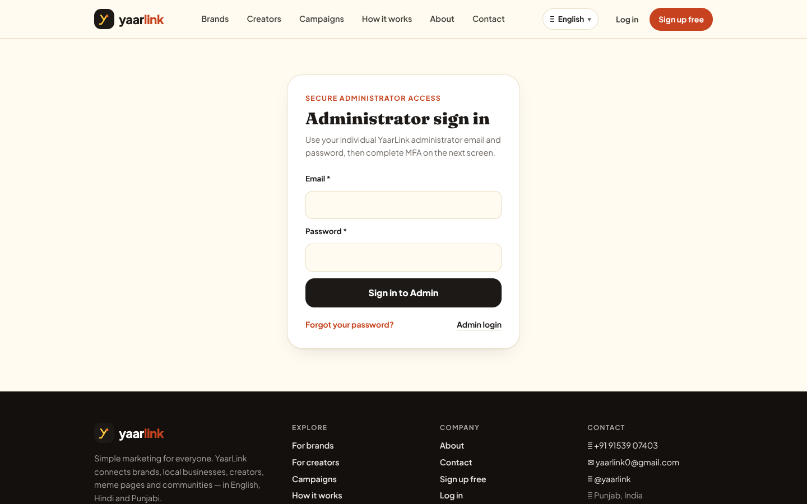
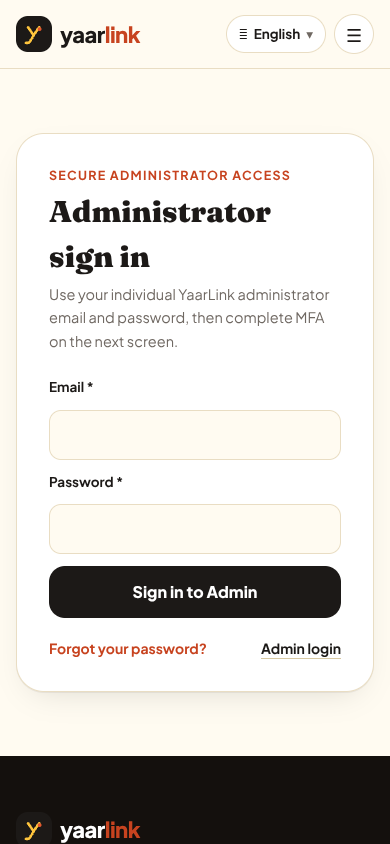
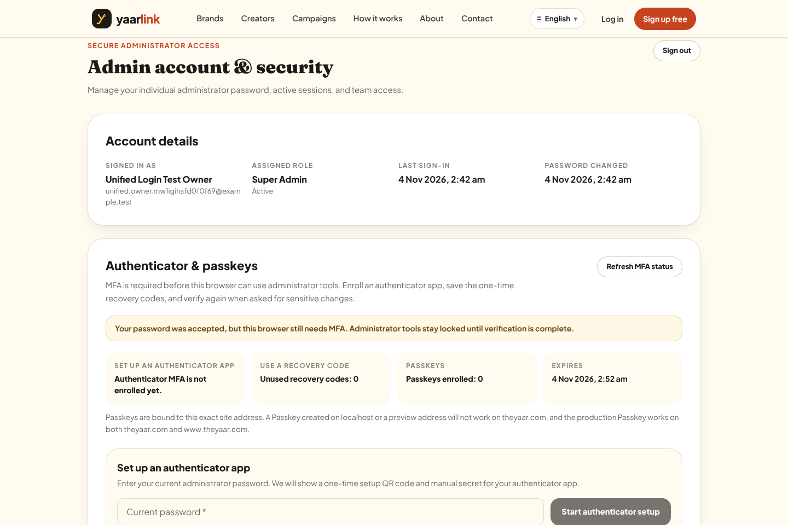
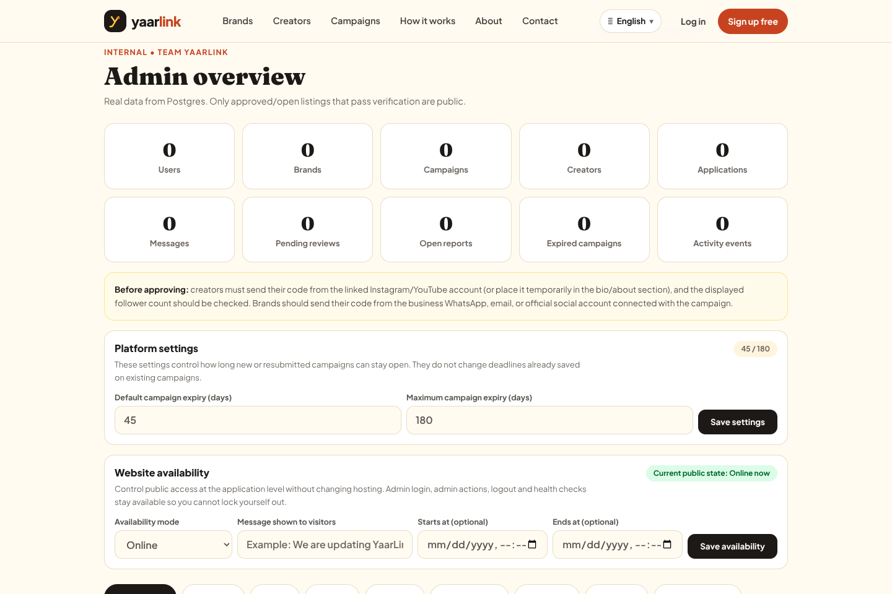

# YaarLink Phase Previews

This is the **Part K** visual-preview record for the YaarLink Super Admin build.
The interactive running application is the primary preview. Screenshots are
supplementary evidence only. Anything labelled **PLANNED** is a design/work
preview, not an implemented or working feature.

Current position: **Development Phase 2B / Production Release 0 (branch-only)**.
Production has not received this work.

---

## Phase 2B — Advanced Admin Security preview

### Preview identity

| Item | Value |
|---|---|
| Date | 2026-11-04 |
| Branch | `arena/9b3c6e40-yaarlink` |
| Base commit | `e4c6a91` plus uncommitted local work |
| App preview port | **4025** (`0.0.0.0:4025`) |
| Browser access | Arena LIVE PREVIEW for port 4025 (`https://4025-…e2b.app`) |
| Internal sandbox URL | `http://localhost:4025` |
| Runtime | Production build started with `npm run start -- --hostname 0.0.0.0 --port 4025` |
| Database | Disposable local PostgreSQL on `127.0.0.1:55432`; synthetic local data only |
| Local service stubs | `127.0.0.1:4026` (email sink/password-range stub; not the app preview) |
| Embedded-preview helper | `0.0.0.0:4027`, a disposable same-origin proxy to the app on 4025. Its root now opens `/admin/sign-in`; direct app headers on 4025 remain strict |
| Production status | Unchanged. No commit, push, PR, migration, credential change, or deployment in this preview step |

### Pages available in the interactive preview

| Page | What to inspect | Current evidence |
|---|---|---|
| `/api/health` | Service health response | HTTP 200 on port 4025 |
| `/admin/sign-in` | **Single official** individual administrator email/password sign-in | HTTP 200; desktop/laptop/tablet/mobile screenshots below; unified-login desktop/mobile screenshots added |
| `/admin/setup` | Invitation/first-owner setup from a one-time local email link | The actual local first owner is already created; do not use an old setup link. New administrators use individual invitations only |
| `/admin/forgot-password` | Administrator password-reset request | HTTP 200; desktop screenshot below |
| `/admin/reset-password` | Administrator password-reset completion | HTTP 200 without using a real token in documentation |
| `/admin/security` | Mandatory MFA enrollment/verification and Passkey/session/account security | Unauthenticated browser checks redirect to `/admin/sign-in`; password-pending users stay here until MFA completes |
| `/admin` | Protected Super Admin dashboard only | No login form. Unauthenticated browser checks redirect to `/admin/sign-in`; MFA-pending checks redirect to `/admin/security` |

Unauthenticated API checks on the restarted port-4025 app returned **401**
for `/api/admin/data` and `/api/admin/identity/me`, while POSTs to the retired
`/api/admin/login` and `/api/admin/logout` returned **404**. The same results
were verified through the 4027 preview helper. These are access-control smoke
checks in addition to the authenticated browser suite below.

### Planned vs implemented vs working vs pending

| Area | Status | Notes |
|---|---|---|
| Phase 2B plan | Defined | TOTP, recovery codes, WebAuthn Passkeys, mandatory MFA, step-up authentication, account-recovery drill, and one official DB administrator login |
| Implemented locally | Yes | TOTP/recovery/Passkey backend, APIs, schema/migration work, EN/HI/PA UI, session MFA state, step-up checks, security events, protected `/admin`, official `/admin/sign-in`, and deletion of the legacy shared-password routes/module are present on this branch |
| Working in disposable tests | Yes, with limits | Prior runs passed TOTP/recovery **100/100** and software-authenticator Passkey **88/88**; the unified-login rebuild passed **67/67** unit tests and a real-Chromium **66/66** suite on a fresh disposable DB |
| Working in this browser preview | Rebuilt 2026-11-04 after sandbox reset; owner setup + enrollment pending | Fresh probes: health 200, retired routes 404, protected APIs 401, public pages 200. Synthetic Super Admin/Analyst journeys previously completed in Chromium (66/66). The rebuilt local DB has zero administrators, so the owner must repeat local first-owner setup, then personally sign in and enroll |
| Physical Passkey proof | **Pending** | Chromium used a CDP virtual authenticator; no real platform-authenticator/hardware-key ceremony has been proven yet |
| Staging proof | **Pending** | No staging migration, RP-ID/origin, email, or device evidence yet |
| Production readiness | **Not ready** | Backup/PITR, rollback preparation, staging/recovery drill, production env-retirement change, production incident diagnosis, owner approval, commit/PR, and deployment checks remain |

### Rebuild validation for this preview

The sandbox runtime had to be repaired after the previous processes and
generated local files disappeared. After repair, the following passed before
starting port 4025:

- `npm test` — **65/65**
- `npm run typecheck`
- `npm run lint`
- `npm run db:check`
- `git diff --check`
- `npm run build`
- Disposable bootstrap verified **24 tables**, RLS/grants, and app-role writes
- Port-4025 smoke: `/api/health`, `/admin/setup`, `/admin/sign-in`,
  `/admin/forgot-password`, `/admin/reset-password`, `/admin/security`, and
  `/admin` returned HTTP 200
- Unauthenticated MFA/Passkey API smoke returned HTTP 401 with matching
  host/origin

### Unified-login validation update — 2026-11-04

After retiring the legacy shared-password path locally:

- `npm run build` passed and its route list contains no
  `/api/admin/login` or `/api/admin/logout`;
- `npm run typecheck`, `npm run lint`, `npm run db:check`, and
  `git diff --check` passed;
- `npm test` passed **67/67**, including tests proving
  `ADMIN_PASSWORD`/`ADMIN_TOTP_SECRET` are no longer startup dependencies
  while `ADMIN_SESSION_SECRET` remains mandatory;
- a fresh disposable DB bootstrap verified 24 tables/RLS/grants/app-role
  writes;
- a real Chromium suite passed **66/66** with dedicated synthetic Super
  Admin and Analyst accounts. It covered generic credential failures,
  unauthenticated/pending API denial, mandatory TOTP enrollment with QR and
  manual key, wrong password/TOTP rejection, recovery-code login, Passkey
  registration/login with a Chromium virtual authenticator, Analyst RBAC
  denial, session revocation/expiration, retired-route 404s, and mobile
  sign-in. The final DB summary was 2 admins (1 Super Admin, 1 Analyst), 2
  TOTP-enrolled, 1 Passkey owner, 6 sessions, 4 revoked, and 1 expired;
- the suite reset only the disposable DB's limiter/lockout tables between
  separate legitimate journeys, so it is not production rate-limit evidence;
- all disposable unified-login E2E databases were dropped after the clean
  run;
- `ADMIN_PASSWORD` and `ADMIN_TOTP_SECRET` were then removed from the local
  `.env.local` only. The actual app restarted on 4025 and direct/helper
  browser checks landed on `/admin/sign-in`; protected data returned 401 and
  retired routes returned 404.

### Real screenshots captured from the running app

Captured from the actual application with headless Chromium in the sandbox.
The original Phase 2B screenshots are unauthenticated. The unified-login
screenshots came from the separate disposable Chromium suite and contain only
synthetic test-account labels/zero counts; the enrollment image was captured
before beginning setup, so it contains no QR code, manual TOTP secret,
password, setup token, or recovery code. No customer or production data is
shown.

| View | File |
|---|---|
| Admin sign-in — desktop 1440×900 | `docs/previews/phase-2b/admin-sign-in-desktop.png` |
| Admin sign-in — laptop 1366×768 | `docs/previews/phase-2b/admin-sign-in-laptop.png` |
| Admin sign-in — tablet 768×1024 | `docs/previews/phase-2b/admin-sign-in-tablet.png` |
| Admin sign-in — mobile 390×844 | `docs/previews/phase-2b/admin-sign-in-mobile.png` |
| Security page unauthenticated gate — desktop | `docs/previews/phase-2b/admin-security-unauthenticated-desktop.png` |
| Admin entry unauthenticated — desktop | `docs/previews/phase-2b/admin-dashboard-login-desktop.png` |
| Forgot password — desktop | `docs/previews/phase-2b/admin-forgot-password-desktop.png` |
| Unified official sign-in — desktop | `docs/previews/phase-2b/unified-login-sign-in-desktop.png` |
| Unified mandatory MFA enrollment, before secret reveal — desktop | `docs/previews/phase-2b/unified-login-mfa-enrollment-desktop.png` |
| Unified Super Admin dashboard after MFA — synthetic desktop | `docs/previews/phase-2b/unified-login-dashboard-desktop.png` |
| Unified official sign-in — mobile | `docs/previews/phase-2b/unified-login-sign-in-mobile.png` |

Desktop sign-in:

Mobile sign-in:

Unified-login mandatory MFA stage (synthetic account, before any QR/manual
secret is shown):

Unified-login dashboard after MFA (synthetic disposable database):

Unified official sign-in on mobile:

### Owner interactive test for this preview

**2026-11-04 rebuild note:** the sandbox was reset and the local stack was
rebuilt from source. The earlier disposable local Super Admin account did
not survive (local-only data; production was never involved). The rebuilt
local database currently has **zero administrators**, so first-owner setup
must be repeated locally. Do not use any old setup link, ordinary
`/signup`, or any shared password — none of those can create administrator
access.

**Setup-helper incident + fix (2026-11-04):** the owner's first submission
on the 4027 setup form returned “Session check failed.” Investigation
(helper logs, sanitized DB counts, outbox summary — no token printed)
showed the request reached the helper but failed its cookie-based CSRF
compare **before** any invitation existed: the preview context does not
return a `SameSite=Lax` cookie on the form POST, so the check could never
pass. No admin, token, or email was created by that attempt (verified:
0 admins / 0 tokens / 0 events). The disposable helper now uses
server-side single-use synchronizer tokens (20-minute expiry, consumed on
first use, unreadable cross-origin under SOP) plus a strict Origin/Host
check whenever the browser sends a real Origin; an opaque `Origin: null`
(still produced by sandboxed frames, and by `Referrer-Policy:
no-referrer` documents — found by differential browser test) falls back
to the token as the CSRF barrier instead of hard-failing. The innocuous
form page uses `Referrer-Policy: same-origin`; the token-bearing redirect
keeps `no-referrer`. CSRF, Origin validation, and rate limiting were not
disabled. Verified afterwards: negative tests 7/7 against the real helper
(bogus/foreign-origin/replay all 403, no issuance), and a real-Chromium
end-to-end run on a separate disposable database/app passed **9/9**
(email submit → redirect to `/admin/setup` → token inspect 200 bound to
the submitted email → fragment stripped → password creation 200 →
sign-in 200 → MFA-pending `/admin/security`; disposable DB confirmed one
active Super Admin, token used, then the whole test stack was dropped).
The actual local database still has zero administrators — the owner's
first-owner slot was never consumed by testing.

**Sign-in redirect-loop incident + fix (2026-11-04):** the owner then
completed first-owner setup (local DB: 1 active Super Admin, MFA not yet
enrolled) but every sign-in flashed “Admin account & security” and
bounced back to `/admin/sign-in`. Sanitized DB checks proved password
auth was succeeding (five `admin.login` events; five persisted
10-minute pending sessions, since expired naturally). Reproduced in
real Chromium: top-level sign-in worked end-to-end, while the same flow
inside a cross-site iframe (mirroring the embedded Arena preview)
showed login 200 + `Set-Cookie`, an empty cookie jar afterwards, and
cookieless `/api/admin/identity/me` → 401 → guard redirect. Root cause:
browsers refuse to store/send `SameSite=Strict` cookies in cross-site
embedded frames. Fix (`shared/admin-cookie.ts`, used by
`backend/admin-identity.ts` + password-reset route): Strict stays the
default; `ADMIN_COOKIE_SAME_SITE=none` is honored only with a loopback
`APP_URL`, switching the local cookie to `SameSite=None; Secure;
Partitioned` (CHIPS). Enabled in local `.env.local` only; production
unaffected. Verified post-fix in real Chromium on a disposable stack
(all checks passed): full TOTP enrollment with QR + manual key, 10
recovery codes shown once, dashboard, logout, MFA-required re-login,
iframe sign-in with the partitioned cookie stored and sent, pending
sessions still denied dashboard APIs, unauthenticated checks unchanged,
no page errors. Screenshots (synthetic, secret-safe):
`docs/previews/phase-2b/redirect-fix-security-pending.png`,
`docs/previews/phase-2b/redirect-fix-dashboard.png`. Test stack dropped
afterwards; the owner's account/password/sessions were never modified.
**Correction (later 2026-11-04):** the owner still hits the identical
bounce in their actual browser (four further successful `admin.login`
events at 04:30–04:32Z against the rebuilt app). A probe against the
real running 4025 process (temporary test admin, inserted and fully
deleted) confirmed it now emits `SameSite=none; Partitioned` and
answers `/me` 200 with that cookie through both 4025 and 4027, so the
failure sits beyond sandbox visibility — the public preview proxy
(E2B traffic-token gated; headers not inspectable from here) and/or
Chrome's third-party-cookie handling in the embedded frame. The
headless loopback result does **not** count as fixed. Current
instruction to the owner: open the preview in a **standalone browser
tab via the preview pop-out** (first-party context; do not paste the
raw e2b URL — it is token-gated), then sign in and enroll there.

First-owner setup is **already completed** — do not use the 4027 setup
form again (it will correctly report that setup is complete).

1. Reload the Arena LIVE PREVIEW named **YaarLink Local Preview**
   (port 4025) — or stay on the 4027 preview, both serve the same app —
   and go to `/admin/sign-in`. Enter your administrator email and the
   password you chose during setup. The assistant does not know or
   receive it.
2. A correct password opens `/admin/security` with only a **10-minute pending
   session**. Complete enrollment promptly: re-enter the same individual
   password under “Set up an authenticator app,” scan the QR code or enter
   the manual key in your authenticator, submit the first six-digit code,
   save all one-time recovery codes in a password manager/secure offline
   place, and choose “I saved these codes.”
3. The flow should then open the Super Admin dashboard at `/admin`. There is
   no second owner/shared-password page.
4. From Admin account & security, optionally add a real Passkey on this
   preview origin, sign out, sign in again, and verify with that Passkey.
   This local Passkey is bound to the preview/localhost RP and will not work
   as a production credential.
5. Report only success/failure, browser/device type, the page where any
   problem occurs, and any non-sensitive visible error. Never share the
   password, QR/manual TOTP secret, recovery codes, cookies, or tokens in
   chat or screenshots.

Sanitized database checks: at `2026-11-04T02:44:48Z` (pre-reset) the local
account was one active Super Admin with TOTP `not_started`. After the
sandbox reset and rebuild the new local database had 0 administrators;
the owner then repeated first-owner setup (completed 2026-11-04T03:56Z).
Latest check: **1 active Super Admin**, TOTP not yet enrolled, zero
recovery codes/Passkeys, zero live sessions (the five pending sessions
from the redirect-loop attempts expired naturally). Enrollment—not MFA
recovery or a password reset—is the correct next owner action.

### What is not shown or proven by the screenshots

- The unified screenshots show a synthetic authenticated dashboard and the
  MFA stage **before** secret reveal. No QR code, manual TOTP secret,
  recovery-code set, real owner dashboard, or physical-device Passkey prompt
  is captured.
- Headless Chromium with a CDP virtual authenticator does not prove a
  physical Passkey ceremony.
- Local stubs do not prove production email delivery, production rate limits,
  hosted backup/PITR, or the production `theyaar.com`/`www.theyaar.com`
  WebAuthn origin behaviour.
- Existing production remains on rollback deployment
  `dpl_HbawYLErKyw7ZWP1ePzcvw5LiVLB`. The failed redeploy
  `dpl_DsRgoApAhB7pR438VRwsiXWehakm` still needs runtime-log diagnosis and
  the owner's production admin login remains separately unverified.

---

## Next phase preview — Phase 3 Core Dashboard

**Status: PLANNED ONLY. The following is not implemented and must not be read
as a working feature or screenshot substitute.**

### Planned outcome

Build the first real Super Admin dashboard shell and overview using existing
YaarLink data and the Phase 2 identity/RBAC foundation, without fake metrics
or placeholder actions.

### Planned pages and navigation

- Authenticated `/admin` overview with a role-aware sidebar.
- Planned sidebar groups, subject to permission inspection:
  Overview, Marketplace, Website, Users, Moderation, Analytics,
  Notifications, Security, Audit Logs, and System Health.
- Overview widgets only where a trustworthy server-side data source exists.
  unavailable data must be shown as unavailable/not configured, never as a
  fabricated zero.
- Security/audit/system summaries linking to real underlying records or
  clearly unavailable states.

### Planned backend and database scope

- Server-side aggregate/read APIs protected by administrator session, MFA
  state, and RBAC/field permissions.
- Reuse existing creator, campaign, user, contact, setting, audit, and
  security-event records where available.
- Database changes only if inspection proves an index, view, or additive
  field is needed; migrations must be backward-compatible and staging-tested
  before any production proposal.

### Expected appearance

Continue the existing YaarLink visual language: warm light surfaces, clear
cards/tables, responsive sidebar/drawer behaviour, EN/HI/PA labels where the
existing i18n system supports them, visible environment/data-freshness state,
and no public creator-directory exposure. Exact layout will be shown as a
labelled plan before implementation and then replaced by a real interactive
Phase 3 preview after implementation.

### Main risks and gates before Phase 3 is called complete

- Resolve the specification's Moderator/Support Admin/Finance Admin/Security
  Admin names against the currently implemented eight-role taxonomy.
- Prevent permission leakage in aggregate counts and links.
- Distinguish live, stale, unavailable, and not-configured metrics.
- Prove desktop/laptop/tablet/mobile behaviour in the actual application.
- Keep production untouched until the release gates in
  `docs/YAARLINK_MASTER_PROGRESS.md` are satisfied and explicitly approved.

---

## Production readiness statement

Phase 2B is **locally advanced but not production-complete**. This preview is
Release 0 evidence only. Legacy shared-password code is retired locally, but
no Phase 2B code, migration, or production env removal should be deployed
until the owner's local enrollment/physical-device evidence, staging
evidence, recovery drill, hosted backup/PITR verification, rollback plan,
security/regression review, and explicit owner production approval are
complete.

### 2026-11-04 — Diagnostic trace of the owner's real 4030 sign-in (issue still open)

The owner signed in once through the 4030 diagnostic preview (Chrome 156, Windows).
The sanitized trace proves: `POST /api/admin/identity/login` → **200** with
`Set-Cookie: __Host-yl_admin_account[…; Secure; HttpOnly; SameSite=none; Partitioned]`
leaving the diagnostic proxy at 04:57:42Z and again at 04:58:44Z; the matching
pending sessions were persisted in the local database (created 04:57:42.119Z /
04:58:44.561Z). **Every** subsequent request from the owner's browser arrived
with **zero cookies**, and `GET /api/admin/identity/me` therefore returned
**401 `unauthorized`**, which triggers the client-side redirect at
`app/admin/security/page.tsx:112`. The backend and the in-sandbox proxy are
exonerated (an internal through-the-same-tap probe with the cookie presented
returns `/me` 200). The cookie is lost somewhere across the public
Arena/E2B preview proxy and/or the browser's embedded-frame cookie policy;
the tap cannot see that segment. A cookie-variant self-test page now fronts
port 4030 (five server-set variants + two JS-set, names-only echo) to
separate "browser won't store", "browser won't send", and "preview proxy
strips cookies" without another sign-in. Authentication remains **not
complete**; Super Admin redirect still **not fixed** pending the owner's
self-test results and personal end-to-end verification. No product code,
account, session, or production change.

### 2026-11-04 — Cookie self-test results from the owner's real browser (embedded frame)

The owner opened the 4030 diagnostic self-test page in the embedded preview
(Chrome 156, Windows). Across six automatic runs (05:06:47Z–05:12:02Z) the
result was identical every time: `jsVisible=[yl-v1,yl-v3,yl-v6]`,
`serverReceived=[]`. Conclusions from real-browser evidence:
- `Set-Cookie` **does** reach the owner's browser through the preview proxy,
  and Chrome **stores** the `Partitioned` test cookies in the embedded frame
  (`yl-v1` server-set `Secure; SameSite=None; Partitioned`, `yl-v3`
  session-partitioned, `yl-v6` JS-set partitioned all visible in
  `document.cookie`). Non-partitioned cookies (`yl-v5` Lax, `yl-v7` plain)
  were not stored, as expected in a third-party frame.
- **No cookie is ever sent back**: every request arriving at the sandbox —
  fetches and full page loads alike — carried zero cookies. The login cookie
  is therefore lost on the return leg between Chrome's cookie jar and the
  sandbox (the preview-proxy path), not in application code and not because
  Chrome rejects the cookie's shape.
- The in-page "open in a new tab" links do nothing inside the embedded
  preview, and the raw `sbx-*.arena.site` preview URLs are Arena-gated
  ("Preview Unavailable — Previews open inside Arena" when fetched
  externally). A dedicated self-test preview on port 4031 now lets the
  owner use the preview panel's own pop-out control to run the identical
  test as a top-level tab — the decisive remaining measurement. Logs
  preserved; no product code, account, or production change. Issue still
  open pending the top-level run and the owner's personal verification.

### 2026-11-04 — Previews after the no-bounce robustness change

4025 `YaarLink Local App — sign in here` rebuilt (`Uyste3IE55nAnsmCTFOr1`)
and restarted: health/sign-in/security return 200; unauthenticated
`/api/admin/identity/me` returns 401 `unauthorized`; legacy
`/api/admin/login` returns 404. New behaviour in the embedded preview: an
accepted password whose session cookie is not returned by the browser now
shows the explicit "Your sign-in could not be confirmed" message on the
sign-in page instead of the flash-and-bounce loop. 4030 diagnostic tap and
4031 cookie self-test remain available; all traces preserved. MFA
enrollment still cannot complete inside the embedded preview (cookies are
never returned across that transport) — pending the owner's choice of
laptop-local run, approved local-preview-only fallback, or standalone-tab
retry. No production change.

### 2026-11-04 — Laptop-local delivery published (owner's chosen path)

The owner chose to run the real app on their own Windows laptop.
`docs/OWNER_LOCAL_SETUP.md` (14 steps + native-PostgreSQL appendix) is the
handoff; the server-side sequence was proven on a disposable database
(fresh bootstrap = 24 tables verified; owner invitation + hashed token +
local outbox setup link verified; database dropped afterwards). Work is
committed and pushed on `arena/9b3c6e40-yaarlink` for
`git clone -b arena/9b3c6e40-yaarlink`. The sandbox 4025 preview remains up
(health 200, no-bounce build). Authentication acceptance is now pending
the owner's laptop run; Part 2 remains gated on their confirmation.
Production untouched.
